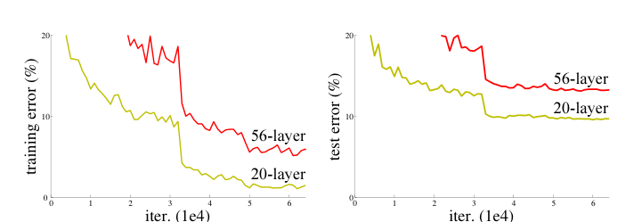
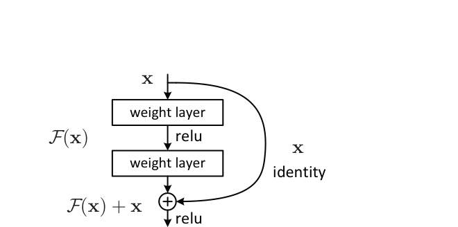

공부할 때 책 한 권을 통째로 처음부터 다시 베껴 쓰는 것과, **원본 노트 위에 수정할 부분(오답)만 빨간 펜으로 덧붙이는 것** 중 어느 쪽이 쉬울까요? 당연히 후자입니다.

2015년 마이크로소프트 리서치(Kaiming He 외)가 발표한 **ResNet**(*Deep Residual Learning for Image Recognition*)은 바로 이 단순하고 강력한 아이디어로 **현대 딥러닝의 모든 아키텍처(CNN, Transformer, Diffusion, VLA)의 기본 뼈대**를 완성했습니다.

## 왜 층을 깊게 쌓으면 오히려 멍청해졌을까?

위 그래프(**Figure 1**)를 보면 충격적인 현상이 나타납니다. 56층 신경망(빨간 선)이 20층 신경망(노란 선)보다 **테스트 오차뿐만 아니라 훈련 오차(Training Error)까지 더 높습니다.** 즉 과적합(Overfitting)이 아니라, 층이 깊어질수록 신경망이 기본적인 정보조차 앞층에서 뒷층으로 제대로 전달하지 못해 학습 자체가 망가지는 **Degradation 문제**가 발생한 것입니다.

## 핵심 컨셉: 원본 $x$를 그대로 넘기는 지름길 ($F(x) + x$)

**Figure 2**의 오른쪽을 감싸고 내려오는 곡선 화살표(`x identity`)가 ResNet의 전부이자 핵심입니다:

- **기존 신경망:** 입력 $x$를 받아 목표 정답 $H(x)$ 전체를 처음부터 끝까지 새로 만들어내야 했습니다.
- **ResNet 블록:** 입력 $x$를 옆 지름길(Skip Connection)로 그대로 내려보내 더해 줍니다. 그러면 가운데 가중치 층들은 정답 전체가 아니라 **원본에서 고쳐야 할 차이값(잔차, Residual: $F(x) = H(x) - x$)**만 배우면 됩니다.
- 만약 어떤 층이 굳이 필요 없다면 가중치를 0으로 만들기만 해도 $F(x) + x = x$가 되어 **최소한 이전 층의 실력은 절대 깎아먹지 않습니다.** 또한 역전파(Backpropagation) 때 기울기가 덧셈 통로($+$)를 타고 소실 없이 맨 앞층까지 고속도로처럼 전달됩니다.

## 로봇·AI 공부에서 왜 꼭 알아야 하나?

- 오늘날 우리가 쓰는 **Transformer의 `Add & Norm`**, **ViT**, **Diffusion Policy의 U-Net/ResNet 비전 인코더**까지 모든 최신 신경망은 이 `Skip Connection (+)` 블록을 기본 부품으로 사용합니다.
- **원문 PDF:** [📄 ResNet 논문 PDF 바로 다운로드 (`arXiv:1512.03385`)](https://arxiv.org/pdf/1512.03385.pdf)
