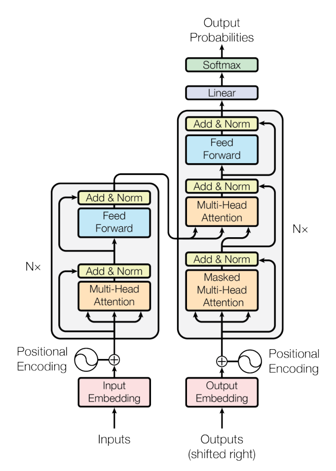
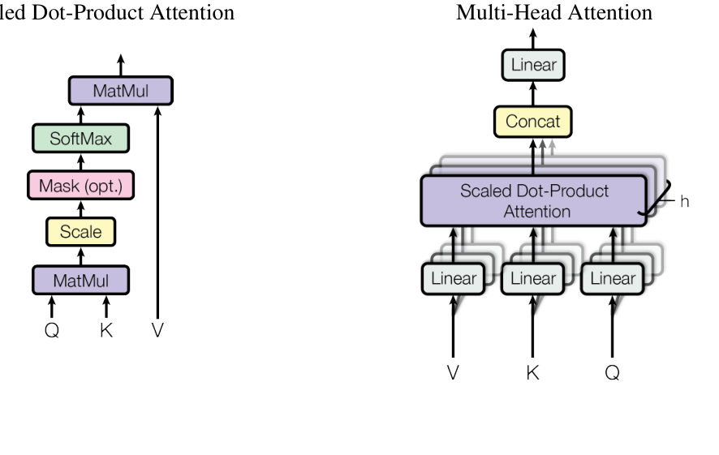

긴 영어 문장을 번역할 때, 앞에서부터 단어 하나만 보고 이전 단어를 머릿속 압축 기억 하나에만 의존해 번역하면 문장이 길어질수록 앞 내용을 까먹게 됩니다. 이것이 기존 RNN/LSTM의 한계였습니다.

2017년 구글 리서치가 발표한 **Transformer**(*Attention Is All You Need*)는 순차 반복(Recurrence)을 완전히 없애고, **"문장 속 모든 단어가 다른 모든 단어와 한꺼번에 직통으로 연결되어 중요한 단어에 집중(Attention)하자"**는 구조로 GPT, Gemini, ViT, 그리고 로봇 VLA 모델의 공통 뼈대가 되었습니다.

## 전체 아키텍처 한눈에 보기 (Figure 1)

위 **Figure 1**은 크게 **왼쪽(인코더: 입력을 이해하는 뇌)**과 **오른쪽(디코더: 답을 한 토큰씩 생성하는 입)**으로 나뉩니다:

1. **Input Embedding + Positional Encoding (맨 아래):** 순차 읽기를 없앴기 때문에 단어의 순서 정보가 사라집니다. 그래서 각 단어 벡터에 **'몇 번째 자리인지 알려주는 사인·코사인 위치 표식(Positional Encoding)'**을 더해줍니다.
2. **Multi-Head Attention + Add & Norm:** ResNet에서 배운 잔차 연결(`Add`)을 감싼 채로 단어 간 관계를 계산합니다.
3. **Masked Multi-Head Attention (디코더 아래):** 답을 생성할 때 미래의 정답 단어를 미리 컨닝하지 못하도록 뒤쪽을 가려놓는(Masking) 장치입니다.

## 핵심 엔진 확대: Scaled Dot-Product & Multi-Head Attention (Figure 2)

**Figure 2**의 `Q, K, V`는 도서관 책 찾기로 비유하면 10초 만에 이해됩니다:
- **Query ($Q$):** 내가 지금 찾고 싶은 검색어 (예: *"그것(it)이 가리키는 게 뭐지?"*)
- **Key ($K$):** 문장 속 각 단어에 붙은 책 제목 라벨
- **Value ($V$):** 실제 책 안에 담긴 내용 정보
- **계산 흐름 (`MatMul → Scale → Softmax → MatMul`):** 내 검색어($Q$)와 모든 단어의 제목($K$)을 내적해 얼마나 관련 있는지 점수를 매기고($\text{softmax}(QK^T/\sqrt{d_k})$), 관련도가 높은 단어의 내용($V$)을 더 큰 비중으로 섞어 가져옵니다.
- **Multi-Head (오른쪽):** 이런 도서관 검색을 **여러 명의 전문가(Head)가 각기 다른 관점(문법, 의미, 공간 위치)**으로 동시에 수행한 뒤 결과를 합치는 방식입니다.

## 로봇·AI 공부에서 왜 꼭 알아야 하나?

- 최신 VLA(OpenVLA, $\pi_0$)와 ACT는 **카메라 이미지 토큰 + 자연어 명령 토큰 + 로봇 관절 토큰**을 모두 이 Transformer의 Self-Attention에 한꺼번에 넣고 관계를 계산합니다.
- **원문 PDF:** [📄 Transformer 논문 PDF 바로 다운로드 (`arXiv:1706.03762`)](https://arxiv.org/pdf/1706.03762.pdf)
