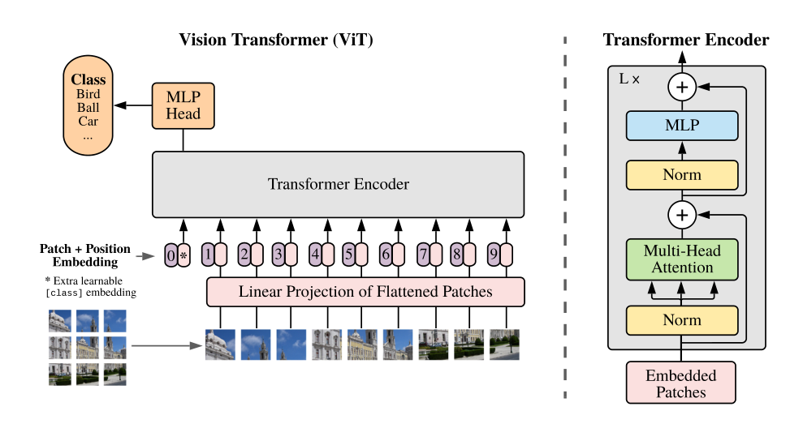

2020년까지 딥러닝 세상은 둘로 갈라져 있었습니다. **글(언어)은 Transformer**, **그림(비전)은 CNN(ResNet)**이 담당했죠. 그런데 로봇에게 *"사진을 보고 말로 이해해서 행동해라"*라고 시키려면, 사진과 언어가 똑같은 언어로 대화할 수 있어야 합니다.

2020년 구글 브레인이 발표한 **ViT**(*An Image is Worth 16x16 Words*)는 아주 대담한 질문에서 출발했습니다: **"사진도 퍼즐 조각처럼 잘라서 일렬로 늘어놓으면, 문장 속 단어들이랑 똑같이 Transformer에 넣을 수 있지 않을까?"**

## 핵심 컨셉: 이미지를 패치 토큰으로 바꾸는 파이프라인 (Figure 1)

위 **Figure 1**의 왼쪽 아래에서 위로 화살표를 따라가 보면 구조가 놀라울 정도로 깔끔합니다:

1. **패치 분할 (Patchify):** $224 \times 224$ 사진을 $16 \times 16$ 크기의 정사각형 타일(Patch) 196개로 자릅니다.
2. **선형 투영 (`Linear Projection of Flattened Patches`):** 각 그림 타일을 1차원 벡터로 쭉 펴서 단어 임베딩처럼 변환합니다.
3. **위치 번호표 부착 (`Patch + Position Embedding`):** 그림 조각을 일렬로 펼쳤기 때문에 어느 조각이 왼쪽 위였는지 표시하는 번호표(`1, 2, ..., 9`)를 붙여줍니다. 맨 앞의 `0 [*]`은 사진 전체를 요약해 담을 특수 빈 상자(`[class]` 토큰)입니다.
4. **Transformer Encoder (오른쪽 확대 블록):** 이제 텍스트용 Transformer와 100% 동일한 `Norm → Multi-Head Attention → + → Norm → MLP → +` 블록을 $L$번 통과합니다.
   - **CNN과의 결정적 차이:** CNN은 첫 층에서 바로 옆 픽셀(3×3)만 좁게 보지만, ViT는 **첫 번째 층부터 사진의 왼쪽 끝과 오른쪽 끝 조각이 Attention으로 직접 대화**할 수 있습니다.

## 로봇·AI 공부에서 왜 꼭 알아야 하나?

- OpenVLA가 쓰는 **SigLIP / DINOv2**, $\pi_0$가 쓰는 **PaliGemma의 시각 인코더**가 전부 이 ViT 구조입니다.
- 카메라에서 들어온 이미지를 ViT로 패치 토큰들로 바꾸고, 그 옆에 `"fold shirt"` 같은 텍스트 토큰을 나란히 이어 붙이기만 하면 곧바로 **VLM과 VLA**가 완성됩니다.
- **원문 PDF:** [📄 ViT 논문 PDF 바로 다운로드 (`arXiv:2010.11929`)](https://arxiv.org/pdf/2010.11929.pdf)
