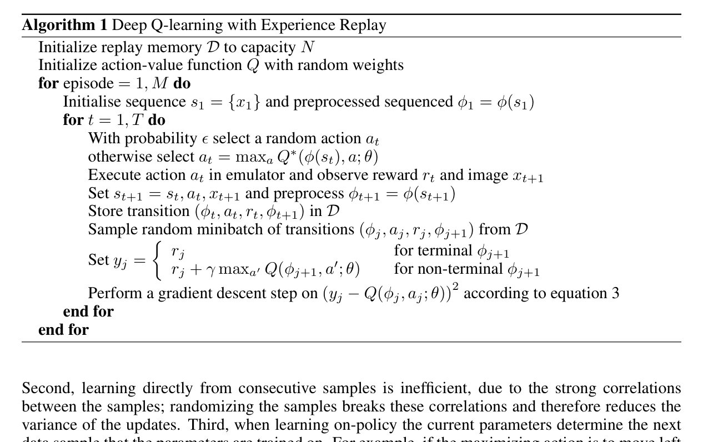

기존 강화학습(Q-Learning)은 **'현재 상황 → 각 행동의 예상 점수(Q값)'**를 커다란 엑셀 표에 적어두고 외우는 방식이었습니다. 하지만 바둑판이나 로봇 카메라 화면처럼 픽셀 조합이 우주 별 개수보다 많은 세상에서는 표를 만들 수가 없습니다.

2013년 딥마인드가 발표한 **DQN**(*Playing Atari with Deep Reinforcement Learning*)은 이 표를 딥러닝 신경망(CNN)으로 대체해, **오직 게임 화면 픽셀과 점수만 보고 벽돌깨기·스페이스 인베이더에서 인간 수준을 뛰어넘는 플레이**를 스스로 터득하게 만들었습니다.

## 핵심 컨셉: 신경망이 왜 강화학습에서 망가졌고, 어떻게 고쳤나?

딥러닝(지도학습)은 문제집에서 무작위로 문제를 섞어 풀지만, 강화학습 에이전트는 **방금 겪은 연속된 장면들(강한 상관관계)**만 계속 보며 학습합니다. 만약 왼쪽 벽만 계속 보며 학습하면 신경망이 오른쪽으로 가는 법을 통째로 잊어버립니다.

위 **Algorithm 1**에서 DQN이 이 문제를 푼 핵심 장치는 두 가지입니다:

1. **경험 리플레이 메모리 (`Initialize replay memory D`):**
   - 로봇/에이전트가 겪은 매 순간의 경험 $(s_t, a_t, r_t, s_{t+1})$을 곧바로 학습에 쓰고 버리지 않고, **일기장(Replay Buffer $D$)에 수십만 개 모아둡니다.**
   - 학습할 때는 일기장에서 **무작위로 미니배치를 섞어 꺼내(Sample random minibatch)** 복습합니다. 덕분에 연속 프레임 간 편향이 사라지고, 한 번 겪은 귀한 경험을 여러 번 재활용(Off-Policy)할 수 있습니다.
2. **벨만 방정식 기반 Q-네트워크 업데이트:**
   - 현재 화면에서 행동 $a$를 했을 때 받을 미래 총점 $Q(s,a)$가 **`지금 받은 보상 r + 다음 화면에서 최선의 행동으로 얻을 최대 점수 γ max Q(s', a')`**와 같아지도록 손실을 줄입니다.

## 한계와 다음 단계(PPO·SAC)로 이어지는 이유

- DQN은 조이스틱 버튼(왼쪽/오른쪽/발사)처럼 **선택지가 몇 개로 끊어지는 이산 행동(Discrete Action)**에서는 강력하지만, 로봇 팔 관절처럼 **연속적인 실수 각도·토크**를 출력해야 할 때는 $\max_{a'} Q(s', a')$를 계산할 수 없습니다.
- 이 한계를 넘기 위해 연속 제어가 가능한 **Policy Gradient / Actor-Critic 계열(PPO, SAC)**로 발전하게 됩니다.
- **원문 PDF:** [📄 DQN 논문 PDF 바로 다운로드 (`arXiv:1312.5602`)](https://arxiv.org/pdf/1312.5602.pdf)
