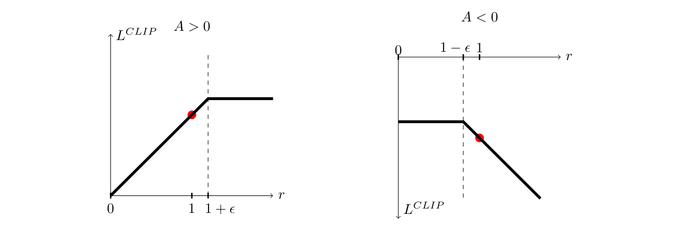

자전거 타기를 배우다가 한 번 우연히 중심을 잘 잡았다고 해서, **"좋아! 다음엔 핸들을 10배 더 세게 꺾어보자!"** 하고 습관을 확 바꿔버리면 바로 크게 넘어집니다. 강화학습에서도 신경망을 한 번에 너무 크게 업데이트하면 로봇이 이상한 자세로 붕괴해 버리고(Policy Collapse), 회복 불능 상태에 빠집니다.

2017년 OpenAI(John Schulman 외)가 발표한 **PPO**(*Proximal Policy Optimization Algorithms*)는 복잡한 수학적 제약(TRPO) 대신 **단 한 줄의 클리핑(Clipping) 안전벨트**로 이 문제를 해결해, 오늘날 **Isaac Sim / Isaac Lab 기반 4족 보행·휴머노이드 학습의 사실상 1순위 표준**이 되었습니다.

## 핵심 컨셉: 그래프 두 개로 끝내는 Clipped Surrogate Objective (Figure 1)

위 **Figure 1**은 강화학습 역사상 가장 유명한 그래프 중 하나입니다. 가로축 $r = \frac{\pi_{\text{new}}(a|s)}{\pi_{\text{old}}(a|s)}$는 **"예전 정책 대비 새 정책이 그 행동을 할 확률이 몇 배 바뀌었는가"**를 뜻합니다 ($r=1$이면 변화 없음).

- **왼쪽 그래프 ($A > 0$, 기대보다 잘한 행동일 때):**
  - 잘한 행동이므로 확률을 높여야 합니다($r$을 1보다 크게).
  - 하지만 **$1 + \epsilon$ (보통 $1.2$, 즉 $+20\%$)**을 넘어가는 순간 그래프가 **평평한 천장**에 부딪힙니다! 아무리 더 키워도 점수를 더 주지 않으므로, 신경망이 과욕을 부려 정책을 망가뜨리지 않습니다.
- **오른쪽 그래프 ($A < 0$, 기대보다 못한 나쁜 행동일 때):**
  - 나쁜 행동이므로 확률을 줄여야 합니다($r$을 1보다 작게).
  - 하지만 역시 **$1 - \epsilon$ (보통 $0.8$, 즉 $-20\%$)** 아래로 내려가면 평평해져서, 한 번의 실수 때문에 기존에 잘하던 동작까지 통째로 망가지는 것을 막아줍니다.

## 로보틱스 실무에서 왜 PPO가 대세인가?

- **구현과 튜닝이 극도로 단순함:** 복잡한 2차 미분 없이 일반 SGD/Adam 옵티마이저로 바로 돌릴 수 있습니다.
- **GPU 병렬 시뮬레이터와 환상의 궁합:** PPO는 On-Policy(새로 모은 데이터만 쓰고 버림)라 샘플 효율은 SAC보다 낮지만, **Isaac Lab에서 GPU 한 장으로 로봇 4,096대를 동시에 띄워 데이터를 초고속으로 쏟아내는 환경**에서는 압도적으로 빠르고 안정적으로 수렴합니다.
- **원문 PDF:** [📄 PPO 논문 PDF 바로 다운로드 (`arXiv:1707.06347`)](https://arxiv.org/pdf/1707.06347.pdf)
