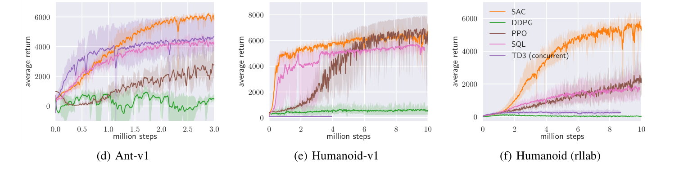

PPO는 시뮬레이터에서 로봇 수천 대를 돌릴 때 최고지만, **실제 로봇(Real-world)**에서는 수천만 번 넘어져 볼 수 없습니다. 적은 시행착오만으로 빠르게 배워야 합니다.

2018년 UC 버클리(Tuomas Haarnoja 외)가 발표한 **SAC**(*Soft Actor-Critic*)는 DQN의 장점(**과거 경험 재활용, Off-Policy**)과 연속 제어의 강점을 합치되, **"점수(Reward)와 호기심(Entropy)을 동시에 극대화하자"**는 우아한 원리로 실물 로봇 RL과 고효율 연속 제어의 대표 주자가 되었습니다.

## 핵심 컨셉: 보상 + 엔트로피(Maximum Entropy RL)

일반 강화학습은 오직 보상 합계 $\sum r_t$만 키우려 합니다. 그러다 보면 우연히 찾은 어설픈 요령 하나에만 일찍 갇혀버려(Local Optimum), 환경이 조금만 바뀌어도 무너집니다.

SAC는 목표 함수에 **행동 분포의 엔트로피(무작위성/다양성) $\mathcal{H}(\pi(\cdot|s_t))$**를 더해줍니다:

$$\text{목표} = \sum_t \mathbb{E}\Big[ r(s_t, a_t) + \alpha \mathcal{H}(\pi(\cdot | s_t)) \Big]$$

- **쉬운 비유:** 로봇에게 **"목표를 달성해서 점수를 따되, 똑같은 방법으로만 하지 말고 가능한 한 여러 가지 유연한 방법으로 성공해 봐!"**라고 가르치는 것입니다.
- 덕분에 탐색(Exploration) 능력이 극대화되고, 학습 도중 누군가 로봇을 살짝 밀어도(외란) 다양한 대응법을 이미 알고 있어 훨씬 강건합니다.
- 또한 **두 개의 Critic(Q-네트워크) 중 더 보수적인(작은) 값**을 쓰는 Double-Q 트릭으로 과대평가(Overestimation) 폭주까지 깔끔하게 막았습니다.

## 실험 결과 확인: 고차원 로봇 제어에서의 압도적 효율 (Figure 1)

위 **Figure 1**의 세 그래프(`Ant-v1`, `Humanoid-v1`, `Humanoid rllab`)를 보면 SAC의 위력이 한눈에 드러납니다:
- **주황색 선(SAC)**은 관절 수가 많아 가장 어려운 `Humanoid` 환경에서도 **갈색 선(PPO)**보다 훨씬 적은 스텝 만에 수직 상승하며, 기존 Off-Policy 방식인 **초록색 선(DDPG)**이 아예 학습에 실패하는 구간에서도 안정적으로 최고 점수를 찍습니다.

## 로보틱스 실무 요약: PPO vs SAC

- **시뮬레이션 대량 병렬 학습 (Isaac Lab):** → **PPO**
- **실물 로봇 온라인 학습 / 시뮬레이션이 무겁고 데이터가 귀할 때 (예: HIL-SERL):** → **SAC**
- **원문 PDF:** [📄 SAC 논문 PDF 바로 다운로드 (`arXiv:1801.01290`)](https://arxiv.org/pdf/1801.01290.pdf)
