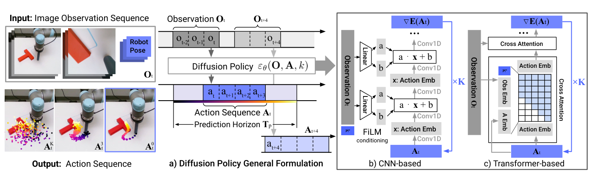

책상 한가운데 놓인 T자 블록을 밀어 목표 위치에 맞추는 작업을 생각해 봅시다. 시연자 A는 **블록의 왼쪽**으로 돌아서 밀었고, 시연자 B는 **오른쪽**으로 돌아서 밀었습니다. 둘 다 완벽한 정답입니다.

그런데 일반 신경망(MSE 손실 함수)으로 이 데이터를 학습시키면 어떻게 될까요? 왼쪽 정답과 오른쪽 정답의 **정중앙 평균값**을 계산해서, 블록을 옆으로 돌지 않고 **정면으로 들이받아 버립니다.** 2023년 컬럼비아대·TRI·MIT 공동 연구진이 발표한 **Diffusion Policy**(*Visuomotor Policy Learning via Action Diffusion*)는 이미지 생성 AI(Stable Diffusion)의 원리를 로봇 행동 생성에 가져와 이 문제를 완벽히 해결했습니다.

## 핵심 컨셉: 무작위 점 구름에서 깔끔한 로봇 궤적 1개를 조각하기 (Figure 2)

위 **Figure 2**를 왼쪽에서 오른쪽으로 따라가 보면 핵심 구조가 한눈에 들어옵니다:

1. **왼쪽 아래 (`Output: Action Sequence` — $A_t^K \to A_t^3 \to A_t^0$):**
   - 처음($A_t^K$)에는 흩뿌려진 완전한 **무작위 노이즈 점들**에서 출발합니다.
   - 신경망 $\varepsilon_\theta(O, A, k)$가 카메라 화면($O_t$)을 보면서 **$K$번에 걸쳐 노이즈를 조금씩 깎아내면($A_t^K \to \dots \to A_t^0$)**, 마침내 왼쪽 혹은 오른쪽 중 **딱 하나의 일관되고 매끄러운 이동 궤적**이 조각처럼 완성됩니다!
2. **가운데 (`a) Diffusion Policy General Formulation`):**
   - 1스텝만 예측하지 않고, 앞으로의 **행동 시퀀스 묶음(Prediction Horizon $T_p$)**을 통째로 생성한 뒤 앞쪽 몇 스텝($T_a$)만 실제로 실행하고 다시 카메라를 보고 재계획(Receding Horizon Control)합니다.
3. **오른쪽 (`b) CNN-based` vs `c) Transformer-based`):**
   - 노이즈를 깎아내는 엔진으로 **1D CNN(FiLM 조건부 주입)** 또는 **Transformer(Cross-Attention)** 두 가지 버전을 모두 제안했습니다.

## 로봇·AI 공부에서 왜 꼭 알아야 하나?

- **최신 VLA의 행동 생성기(Action Head) 원조:** 오늘날 $\pi_0$, GR00T, RDT 같은 거의 모든 최신 로봇 파운데이션 모델이 채택한 **Diffusion / Flow Matching 행동 생성 구조**가 바로 이 논문에서 시작되었습니다.
- **원문 PDF:** [📄 Diffusion Policy 논문 PDF 바로 다운로드 (`arXiv:2303.04137`)](https://arxiv.org/pdf/2303.04137.pdf)
