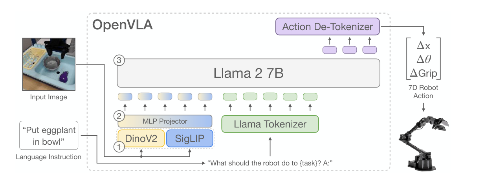

Diffusion Policy는 특정 작업의 손기술은 뛰어나지만, *"싱크대 안 보라색 가지를 그릇에 담아줘(Put eggplant in bowl)"*처럼 처음 보는 물체와 자연어 지시를 이해하는 상식 뇌가 없습니다. 구글이 55B짜리 거대 비공개 모델 **RT-2**로 해법을 보였지만 외부 연구자들은 써볼 수 없었죠.

2024년 스탠퍼드·버클리·도요타연구소(TRI) 등이 공개한 **OpenVLA**(*An Open-Source Vision-Language-Action Model*)는 **97만 개의 공개 로봇 에피소드(Open X-Embodiment)**로 학습한 **7B 오픈소스 VLA**를 공개하며, 크기가 7배 이상 큰 RT-2-X(55B)보다 더 높은 성공률을 기록했습니다.

## 핵심 컨셉: 3단계 OpenVLA 아키텍처 따라가기 (Figure 2)

위 **Figure 2**의 번호 `① → ② → ③ → 출력`을 그대로 따라가 보면 VLA의 동작 원리가 완벽히 이해됩니다:

1. **① 이중 시각 인코더 (`DINOv2` + `SigLIP`):**
   - 왜 눈(ViT)을 굳이 두 개나 달았을까요?
   - **SigLIP**은 *"저게 가지(eggplant)고 옆에 있는 게 그릇(bowl)이다"*라는 **물체의 이름·의미(Semantics)**는 잘 알지만, 정밀한 위치·거리 감각은 약합니다.
   - 반면 **DINOv2**는 자기지도학습 덕분에 **물체의 윤곽선·3D 공간 위치(Spatial Reasoning)**를 기가 막히게 잡습니다. 두 특징을 나란히 이어 붙여 '의미+공간'을 동시에 봅니다!
2. **② `MLP Projector` & `Llama Tokenizer`:**
   - 시각 특징을 언어 모델이 알아듣는 벡터 공간으로 번역해, 텍스트 프롬프트(`"What should the robot do to {task}? A:"`)와 나란히 붙입니다.
3. **③ `Llama 2 7B` → `Action De-Tokenizer`:**
   - Llama 2 언어 모델은 마지막 256개의 잘 안 쓰는 단어 슬롯을 **로봇 이동량 칸(256개 이산 구간)**으로 재정의해 학습합니다.
   - 모델이 7개의 숫자 토큰을 뱉으면 `Action De-Tokenizer`가 이를 실제 **7차원 로봇 명령($\Delta x, \Delta y, \Delta z, \Delta \text{roll}, \Delta \text{pitch}, \Delta \text{yaw}, \Delta \text{Grip}$)**으로 복원해 로봇 팔에 보냅니다.

## 한계와 다음 단계($\pi_0$)로 이어지는 이유

- OpenVLA는 1스텝씩 256개 칸으로 끊어서(이산 토큰화) 출력하기 때문에, **제어 속도가 느리고(약 6Hz) 빨래 개기 같은 빠르고 섬세한 양팔 연속 동작**에는 한계가 있습니다.
- 이 한계를 **VLM + Flow Matching 연속 동작 생성**으로 깨뜨린 다음 단계가 바로 **$\pi_0$**입니다.
- **원문 PDF:** [📄 OpenVLA 논문 PDF 바로 다운로드 (`arXiv:2406.09246`)](https://arxiv.org/pdf/2406.09246.pdf)
