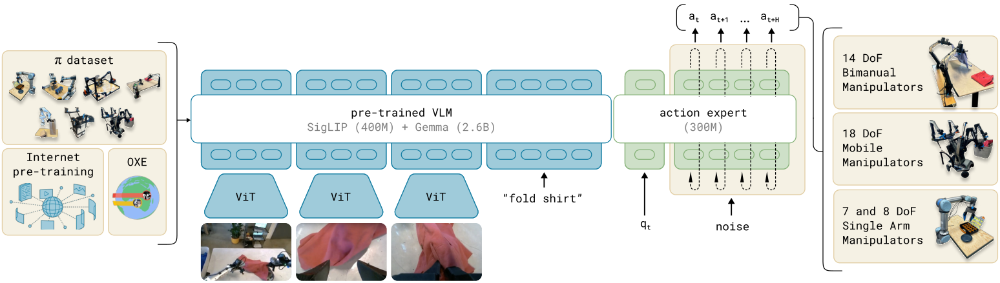

우리 뇌를 보면, 철학이나 언어를 생각하는 **대뇌(VLM)**와 빨래를 개거나 젓가락질을 0.02초 단위로 부드럽게 처리하는 **소뇌(운동 제어기)**가 분리되어 협력합니다.

OpenVLA처럼 대뇌(LLM) 혼자서 로봇 관절 각도를 단어처럼 한 칸씩(256개 구간) 뱉게 하면 너무 느리고(6Hz) 뻣뻣했습니다. 2024년 말 Physical Intelligence가 발표한 **$\pi_0$ (Pi-Zero)**(*A Vision-Language-Action Flow Model for General Robot Control*)는 **사전학습 VLM(대뇌)** 옆에 **연속 동작 전담 Action Expert(소뇌)**를 나란히 붙여, **빨래 개기·식탁 치우기·상자 조립** 같은 초고난도 작업을 최대 **50Hz**로 매끄럽게 해냈습니다.

## 핵심 컨셉: VLM 대뇌 + Flow Matching Action Expert 소뇌 (Figure 3)

위 **Figure 3**의 왼쪽(파란색)과 오른쪽(초록색) 두 블록의 역할 분담이 이 논문의 핵심입니다:

1. **왼쪽 파란 블록 (`pre-trained VLM: SigLIP 400M + Gemma 2.6B` = 대뇌):**
   - 여러 대의 카메라 화면(ViT 통과)과 자연어 명령(`"fold shirt"`)을 받아 **장면의 의미와 작업 맥락**을 깊이 이해합니다.
   - 인터넷 사전학습 지식이 망가지지 않도록 이쪽 가중치를 보존하며 사용합니다.
2. **오른쪽 초록 블록 (`action expert: 300M` = 운동 소뇌):**
   - 현재 로봇 관절 상태($q_t$)와 무작위 노이즈(`noise`)를 입력받습니다.
   - 대뇌(VLM)와 **Self-Attention으로만 정보를 주고받되(Mixture-of-Experts 구조)**, 가중치는 운동 전용으로 따로 씁니다!
   - **Flow Matching**으로 노이즈를 매끄러운 연속 궤적 뭉치(**Action Chunk: $a_t, a_{t+1}, \dots, a_{t+H}$, 50Hz**)로 빠르게 변환해 단일 팔·양팔(14-DoF)·모바일 매니퓰레이터(18-DoF)까지 하나의 모델로 제어합니다.

## 로봇·AI 공부에서 왜 꼭 알아야 하나?

- **Diffusion Policy(연속 다중 경로) + ACT(Action Chunking) + OpenVLA(VLM 백본)** — 앞서 배운 세 가지 혁신을 하나의 깔끔한 아키텍처로 통합한 현대 Physical AI의 표준 레시피입니다.
- **원문 PDF:** [📄 $\pi_0$ (Pi-Zero) 논문 PDF 바로 다운로드 (`arXiv:2410.24164`)](https://arxiv.org/pdf/2410.24164.pdf)
