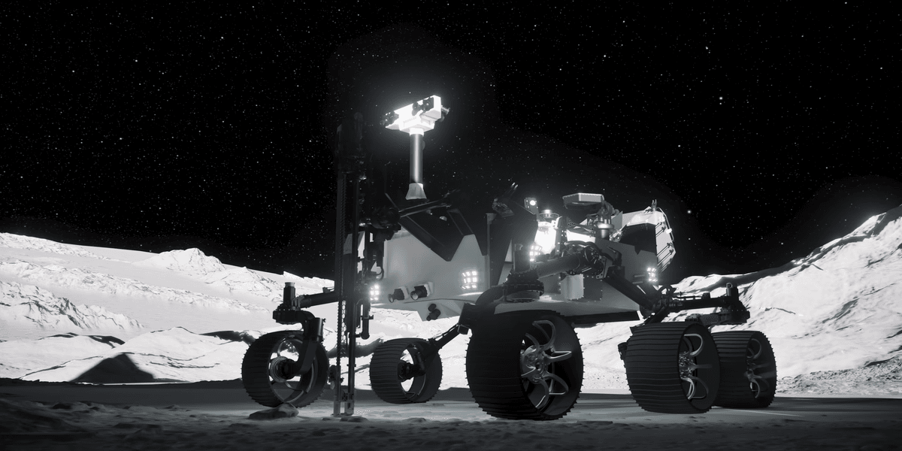

로보틱스 연구가 실험실의 정형화된 환경을 넘어 극한 우주 환경과 고부하 하드웨어 한계 시험으로 확장되는 흐름을 보여주는 주요 시연들이 한꺼번에 공개됐다. 이번 소식은 IEEE Spectrum Robotics가 2026년 11월 13일 발행한 주간 큐레이션([Video Friday: NASA PROMISEs a New Moon Rover](https://spectrum.ieee.org/video-friday-moon-rover-promise))을 통해 전해졌으며, NASA 제트추진연구소(JPL), 보스턴 다이내믹스(Boston Dynamics), 칼텍(Caltech)의 최신 하드웨어·제어 성과를 담고 있다.

## 극한 환경과 하드웨어 한계를 겨냥한 세 가지 기술 진전

이번 큐레이션에서 주목할 첫 번째 변화는 보스턴 다이내믹스의 휴머노이드 로봇 아틀라스(Atlas) 실험이다. 연구진은 아틀라스의 발을 바퀴(wheels)로 교체한 뒤 학습된 제어기(learned controller)가 주행을 담당하도록 구성했다. 이 변형 구성을 통해 아틀라스의 액추에이터와 연구진이 보유한 액추에이터 모델을 강하게 밀어붙이며 한계 성능을 시험할 수 있었다는 점이 핵심이다.

우주 로보틱스 분야에서는 검증된 하드웨어의 재활용과 자동화 조립이 두드러진다. NASA JPL은 달 기지 프로그램(Moon Base Program)의 기초 임무로 달 남극에 투입할 원자력 구동 로버 'PROMISE(Polar Rover for Observation, Mapping, and In-Situ Exploration)' 계획을 공개했다. PROMISE는 신규 설계에만 의존하는 대신, 화성 탐사 로버인 큐리오시티(Curiosity)와 퍼서비어런스(Perseverance)를 위해 개발된 테스트베드 및 비행 예비 부품 등 기존 하드웨어를 대거 활용해 제작될 예정이다.

함께 소개된 NOM4D(Novel Orbital and Moon Manufacturing, Materials and Mass-efficient Design) 프로그램은 궤도 상에서 작동하는 칼텍의 페이로드를 이용해 트러스 구조물을 조립함으로써 최초의 자동화 우주 내 조립(automated in-space assembly) 시연을 달성했다.

## 공개된 근거와 해석 시 유의해야 할 한계

이번 발표에서 확인되는 사실은 각 기관이 공개한 시연 영상과 간략한 프로젝트 설명에 기반한다. 보스턴 다이내믹스가 아틀라스의 발을 바퀴로 교체해 학습 기반 제어기를 구동했고 이를 통해 액추에이터와 관련 모델을 시험했다는 점, NASA JPL이 화성 로버용 기존 부품을 활용해 원자력 기반 달 남극 로버를 구축한다는 점, 그리고 NOM4D가 궤도에서 트러스 구조물을 자동 조립했다는 점은 원문 요약에서 직접 확인된다.

다만 주간 영상 모음(Video Friday)이라는 형식적 특성상, 연구자가 기술적 깊이를 검증하기 위해 필요한 세부 정보는 요약에 포함되어 있지 않다. 구체적으로 아틀라스의 학습 제어기가 어떤 알고리즘과 학습 데이터를 사용했는지, 바퀴 교체 후 주행 속도나 제어 안정성이 어느 정도인지에 대한 정량적 수치는 확인되지 않는다. 마찬가지로 NASA PROMISE의 실제 발사 일정과 임무 수명, 칼텍 NOM4D 트러스 조립의 소요 시간과 정밀도·오차 범위 등도 현재 요약만으로는 알 수 없어 후속 기술 논문이나 공식 보고서를 통한 확인이 필요하다.

## 로보틱스·AI 연구자와 엔지니어 관점의 의미

- **휴머노이드 액추에이터 모델링과 학습 제어의 결합**: 보스턴 다이내믹스의 사례는 동일한 휴머노이드 상체·관절 플랫폼에서 말단(발→바퀴) 형태를 바꾸고 학습 기반 제어기를 적용해 액추에이터와 물리 모델의 한계를 검증하는 접근을 보여준다. 이는 심투리얼(Sim-to-Real) 모델 정합성을 높이려는 제어 엔지니어에게 하드웨어 테스트베드 활용 방식의 시사점을 준다.
- **레거시 하드웨어 기반의 신속한 극한 환경 로버 개발**: NASA JPL의 PROMISE 구상은 우주·극한 환경 로봇 개발에서 검증된 테스트베드와 예비 부품을 재구성해 개발 리스크와 비용을 낮추는 실용적 엔지니어링 전략을 확인시켜 준다.
- **우주 내 자율 조립(In-Space Assembly)의 실증 단계 진입**: 칼텍 NOM4D의 궤도 트러스 조립 시연은 향후 대형 우주 구조물이나 달 기지 인프라 구축에서 지상 발사 후 전개 방식이 아닌 로봇 기반 현장 조립 파이프라인이 실험적 단계를 넘어 실제 궤도 실증으로 이어지고 있음을 보여준다.
