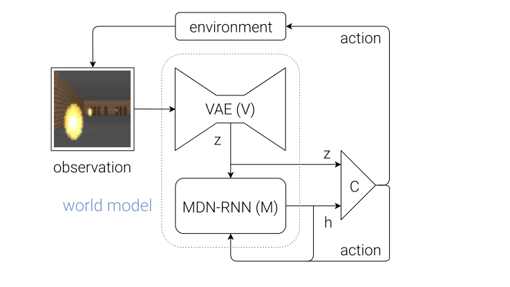

야구 타자가 시속 150km 공을 칠 때, 공이 날아오는 걸 다 보고 나서 반응하면 이미 늦습니다. 사람의 뇌는 공의 궤적을 미리 머릿속에서 예측(**내부 정신 모델, Mental Model**)해서 방망이를 휘두릅니다.

2018년 David Ha와 Jürgen Schmidhuber가 발표한 **World Models**는 인공지능에게도 똑같은 **'머릿속 가상 시뮬레이터'**를 만들어 주자는 발상에서 출발해, 오늘날 모든 월드 모델(Dreamer, Cosmos, WAM)의 설계도를 최초로 정립했습니다.

## 핵심 컨셉: V · M · C 세 모듈의 순환 구조 (Agent Model Diagram)

위 다이어그램의 파란 점선 박스(`world model`) 안팎을 따라가면 구조가 믿기지 않을 만큼 명쾌합니다:

1. **V (`VAE`, 눈 — 공간 압축기):**
   - 카메라/게임 화면(픽셀 수만 개)을 그대로 다루면 너무 무겁습니다. VAE가 현재 장면을 **딱 32개의 숫자로 요약된 잠재 벡터 $z$**로 압축합니다.
2. **M (`MDN-RNN`, 기억 & 상상 엔진 — 시간 예측기):**
   - 현재 요약 화면 $z$, 지금까지의 기억 $h$, 그리고 방금 선택한 행동 `action`을 보고 **"다음 순간의 요약 화면 $z_{t+1}$이 어떻게 바뀔지 확률 분포로 예측"**합니다.
   - 바로 이 V와 M이 합쳐져 AI 머릿속의 **월드 모델(World Model)**이 됩니다.
3. **C (`Controller`, 초경량 반사신경 — 제어기):**
   - 현재 장면 $z$와 M이 예측한 미래 기억 $h$를 받아 **단 한 줄의 단순 선형 방정식($a_t = W_c [z_t, h_t] + b_c$)**만으로 행동을 결정합니다!
   - 복잡한 세상 이해는 V와 M이 다 끝내놓았기 때문에, 제어기 C는 파라미터가 겨우 몇백 개뿐이어도 충분합니다.
4. **꿈속에서 훈련하기 (Training Inside a Dream):**
   - 일단 M이 세상의 물리 법칙을 배우고 나면, 실제 환경(VizDoom)을 꺼버리고 **M이 만들어내는 '가상 꿈속 환경'에서만 C를 수만 번 훈련**시킨 뒤 실제 환경에 투입해 단번에 고득점을 냈습니다.

## 로봇·AI 공부에서 왜 꼭 알아야 하나?

- 실제 로봇은 부딪히면 망가집니다. **"먼저 세상의 물리 변화를 압축·예측하는 월드 모델을 배우고, 그 머릿속 시뮬레이터 안에서 안전하게 정책을 훈련한다"**는 철학이 현대 Physical AI의 핵심 기둥입니다.
- **원문 PDF:** [📄 World Models 논문 PDF 바로 다운로드 (`arXiv:1803.10122`)](https://arxiv.org/pdf/1803.10122.pdf)
