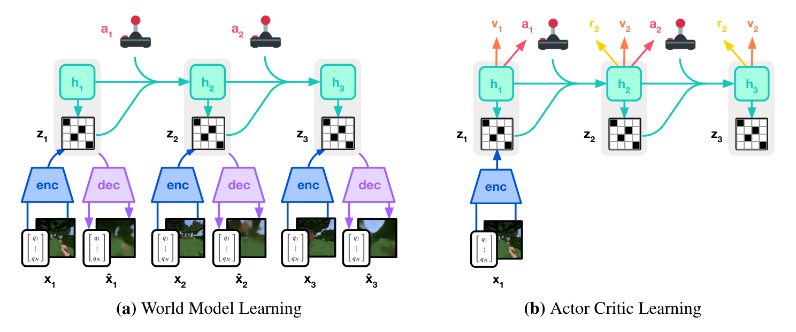

2018년 World Models 이후에도 월드 모델 강화학습에는 치명적인 약점이 있었습니다. 게임이나 로봇 환경이 바뀔 때마다 보상 크기(1점 vs 10,000점)와 손실 비율을 사람이 일일이 손으로 튜닝해야 했고, 조금만 어긋나면 상상 속 세상이 무너져 버렸습니다.

2023년 Danijar Hafner 외 연구진이 발표한 **DreamerV3**(*Mastering Diverse Domains through World Models*)는 **단 하나의 고정된 하이퍼파라미터 세트**로 150개 이상의 전혀 다른 환경(연속 로봇 제어, 아타리, 3D 미로, 그리고 사람 시연 없이 **마인크래프트에서 나무 베기→곡괭이 제작→다이아몬드 채굴**)을 모두 정복했습니다.

## 핵심 컨셉: (a) 세상 배우기 vs (b) 상상 속에서 연습하기 (Figure 3)

위 **Figure 3**의 왼쪽 `(a)`와 오른쪽 `(b)`를 비교해서 보면 DreamerV3의 원리가 완벽하게 보입니다:

1. **왼쪽 `(a) World Model Learning` (세상 물리 법칙 공부):**
   - 실제 카메라 화면 $x_1, x_2, x_3$를 인코더(`enc`)로 압축해 **이산 잠재 표현 $z_t$(바둑판 모양 격자)**로 바꾸고, 과거 기억 $h_t$와 결합합니다(**RSSM** 구조).
   - 디코더(`dec`)가 원래 화면 $\hat{x}_t$를 복원하도록 훈련하면서, 동시에 현재 $h_t, z_t$와 행동 $a_t$만으로 다음 상태 $h_{t+1}, z_{t+1}$를 정확히 맞히도록 학습합니다.
2. **오른쪽 `(b) Actor Critic Learning` (눈 감고 상상하며 정책 훈련):**
   - 주목하세요! 오른쪽 그림에는 **`dec`(화면 복원)도 없고, $x_2, x_3$(실제 다음 화면)도 없습니다!**
   - 맨 처음 화면 $x_1$ 딱 한 장만 본 뒤, 그다음부터는 **월드 모델의 압축된 머릿속 공간($h_1, z_1 \to h_2, z_2 \to h_3, z_3$)**에서 15스텝 앞까지의 미래 보상($r_t$)과 가치($v_t$)를 초고속으로 상상하며 Actor(행동 정책)를 훈련합니다.
3. **도메인 불변 안정화 트릭 (`symlog` 변환):**
   - 보상이 0.01점이든 100만 점이든 로그 스케일처럼 압축하는 `symlog` 변환을 적용해, 환경이 바뀌어도 단 한 줄의 튜닝 없이 안정적으로 수렴하게 만들었습니다.

## 로봇·AI 공부에서 왜 꼭 알아야 하나?

- 픽셀 전체를 생성하는 무거운 비디오 모델 대신 **압축된 잠재 공간(Latent Space)에서 초고속으로 미래를 굴리는 방식**의 교과서이자, 최신 실물 로봇 월드 모델(DayDreamer 등)의 핵심 엔진입니다.
- **원문 PDF:** [📄 DreamerV3 논문 PDF 바로 다운로드 (`arXiv:2301.04104`)](https://arxiv.org/pdf/2301.04104.pdf)
