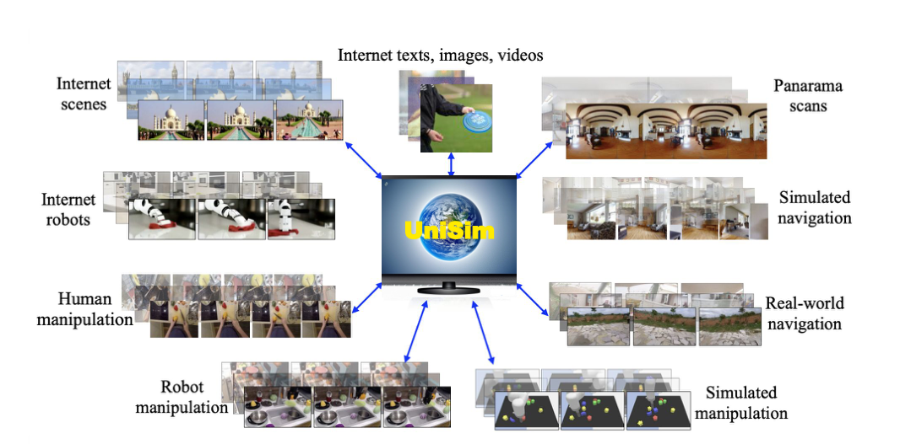
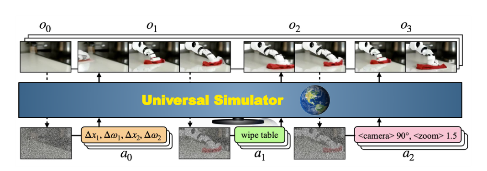

NVIDIA Isaac Sim 같은 3D 물리 시뮬레이터는 훌륭하지만, 수건의 주름, 끈적한 소스, 집 안의 수천 가지 잡동사니를 사람이 일일이 3D 모델링하고 마찰계수를 입력하는 데는 한계가 있습니다.

2023년 말 구글 딥마인드·UC 버클리·MIT 연구진이 발표한 **UniSim**(*Learning Interactive Real-World Simulators*)은 발상을 완전히 뒤집었습니다: **"물리 엔진을 코딩하지 말고, 세상의 온갖 영상을 본 생성형 비디오 모델에게 '내가 이런 행동을 하면 다음 화면이 어떻게 보일까?'를 직접 그리게 하자!"**

## 블록 ① 세상의 모든 데이터를 한 그릇에 담기 (Figure 1)

위 **Figure 1**처럼, 기존에는 로봇 데이터가 너무 적어서 시뮬레이터를 학습시키기 어려웠습니다. UniSim은 각기 다른 출처의 데이터가 가진 강점을 하나로 합쳤습니다:
- **인터넷 사진·영상** → 세상의 다양한 물체와 배경 지식
- **인간 손 조작 영상(Human manipulation)** → 물체를 썰고, 닦고, 옮길 때의 물리 법칙
- **로봇 조작·주행 데이터** → 정밀한 모터 명령($\Delta x, \Delta \omega$)에 따른 화면 변화

## 블록 ② 행동에 반응하는 비디오 월드 모델 구조 (Figure 2)

위 **Figure 2**를 아래(입력 행동)에서 위(생성된 미래 화면)로 읽어보면 구조가 한눈에 들어옵니다:
- 현재 화면($o_0$)과 행동($a_0$)을 주면, **조건부 비디오 확산 모델(Video Diffusion Model)**이 노이즈에서 다음 순간의 영상 프레임($o_1$)을 생성합니다.
- 놀라운 점은 입력 행동 $a_t$의 형태가 하나로 고정되지 않는다는 것입니다:
  - $a_0$: **`Δx₁, Δω₁` (로봇 팔의 정밀 저수준 이동 명령)**
  - $a_1$: **`"wipe table"` (고수준 자연어 지시)**
  - $a_2$: **`<camera> 90°, <zoom> 1.5` (카메라 시점 이동)**
- 이렇게 완성된 생성형 시뮬레이터 안에서 **실제 로봇 정책(VLM 플래너·강화학습 에이전트)을 훈련**한 뒤, 추가 학습 없이 바로 **실제 로봇에 옮겨(Zero-shot Sim-to-Real)** 작업에 성공했습니다.

## 로봇·AI 공부에서 왜 꼭 알아야 하나?

- **NVIDIA Cosmos, Google Genie, World-Action Model(WAM)** 등 2025~2026년 피지컬 AI계를 휩쓸고 있는 **생성형 비디오 월드 모델(Video World Model)** 흐름의 직계 출발점입니다.
- **원문 PDF:** [📄 UniSim 논문 PDF 바로 다운로드 (`arXiv:2310.06114`)](https://arxiv.org/pdf/2310.06114.pdf)
