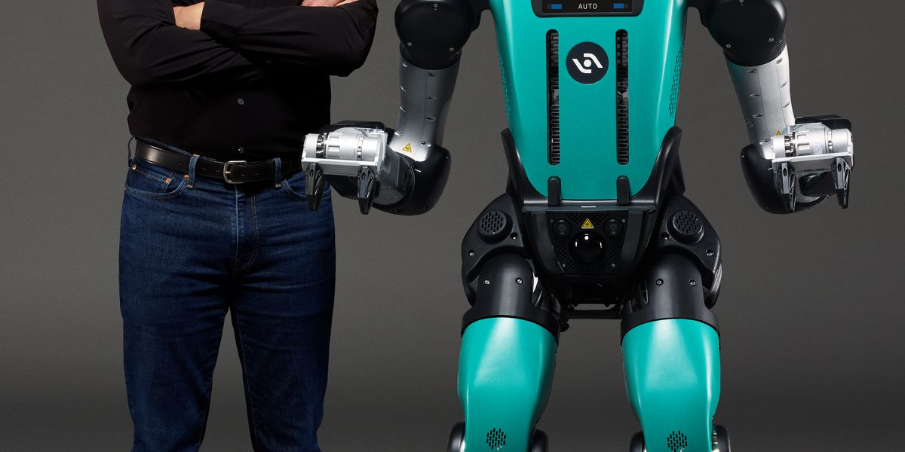

휴머노이드 로봇이 연구실의 유려한 보행 시연을 넘어 실제 물류 창고의 고부하 작업을 연속 수행하려면 어떤 하드웨어 타협이 필요한지 보여주는 사례가 나왔습니다. Agility Robotics 공동 창업자는 [IEEE Spectrum Robotics 기고문](https://spectrum.ieee.org/agility-robotics-digit-5-redesign)(2026년 10월 19일 게재)을 통해 자사 휴머노이드 신형 모델 ‘Digit 5’의 설계 방향과 상용화 전략을 공개했습니다. 수만 대 규모의 산업 현장 배치를 목표로 내세우며, 인간처럼 자연스러운 움직임 대신 상업적 실용성을 우선시한 점이 주목됩니다.

### 생체모방 보행에서 산업용 실용성으로: Digit 5의 핵심 변화

2015년 오리건 주립대(Oregon State University) 로보틱스 연구실에서 출발한 Agility Robotics는 초기 이족보행 연구(ATRIAS)부터 인간처럼 이동(locomotion)과 조작(manipulation)을 결합한 유려한 움직임을 추구해 왔습니다. 그러나 Digit 5는 이러한 초기 이상과 달리 외형이 무겁고 투박해졌으며, 이전 세대 모델들이 보여주던 자연스럽고 우아한 동작 대신 철저히 상용 작업 성능에 초점을 맞춘 재설계를 택했습니다.

이번에 공개된 Digit 5의 핵심 목표 사양은 물류 창고의 연속 교대 근무 환경에 맞춰져 있습니다. 23kg 무게의 빈(bin)을 높은 선반에 들어 올리는 고하중 적재 작업을 수행할 수 있으며, 9분 충전으로 90분간 가동할 수 있는 배터리 운용 능력을 갖췄습니다. 이를 통해 인간 작업자가 기피하는 육체적 고강도·단순 반복 작업을 안전하고 경제적으로 대체하는 것을 목표로 합니다.

### 확인된 설계 근거와 해석 시 주의할 한계

이번 기고에서 확인되는 분명한 근거는, 상용 휴머노이드가 ‘대규모 실전 작업’이라는 문턱을 넘기 위해 제어의 미학보다 페이로드(23kg), 급속 충전 사이클(9분 충전/90분 작동), 연속 가동성이라는 현장의 요구 조건을 우선했다는 점입니다. 창업자 스스로도 회사가 처음 꿈꾸던 로봇의 모습과는 거리가 멀어졌지만, 유용한 상용 제품을 내놓기 위해 다른 경로를 선택했음을 분명히 밝혔습니다.

반면 제공된 요약 정보만으로는 해석 시 주의해야 할 한계도 명확합니다. Digit 5의 전체 중량, 자유도(DoF), 액추에이터 및 센서 구성 등 세부 하드웨어 스펙과 보행·매니퓰레이션을 제어하는 소프트웨어 아키텍처는 공개된 요약 범위에서 확인되지 않습니다. 또한 ‘수만 대의 휴머노이드 작업자 투입’이라는 비전이나 23kg·90분 사양이 실제 고객사 물류 센터의 장기 운용을 통해 검증된 실측치인지, 출시 시점의 목표 성능인지도 추가 확인이 필요합니다.

### 로보틱스·AI 연구자 및 엔지니어 관점의 의미

- **하드웨어-도메인 공동 설계(Co-design)의 현실화**: 동적 보행의 우아함이나 범용성보다 특정 산업 도메인(창고 내 고하중 빈 핸들링)의 가동률과 작업 효율을 극대화하는 하드웨어 재설계가 상용화의 핵심 조건으로 부상하고 있음을 보여줍니다.
- **짧은 충·방전 사이클을 고려한 제어 연구 필요성**: 9분 충전 후 90분 가동이라는 연속 교대 운용 조건이 강조되면서, 향후 제어 정책(policy) 역시 작업 성공률뿐 아니라 에너지 효율과 액추에이터 부하 관리를 함께 최적화하는 방향이 중요해질 것입니다.
- **고하중 플랫폼 기반의 실전 매니퓰레이션 데이터 확보 가능성**: 외형은 투박해졌으나 23kg 적재가 가능한 물리 플랫폼이 현장에 안착할 경우, 창고 환경에서의 실제 접촉·파지(contact-rich manipulation) 데이터를 축적하고 파운데이션 모델을 고도화하는 실증 기반으로 활용될 여지가 있습니다.

