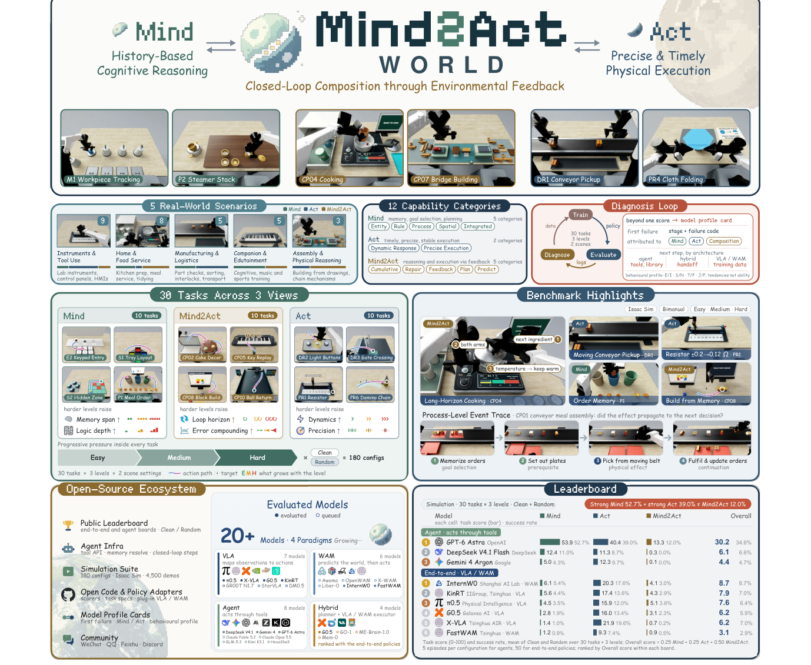
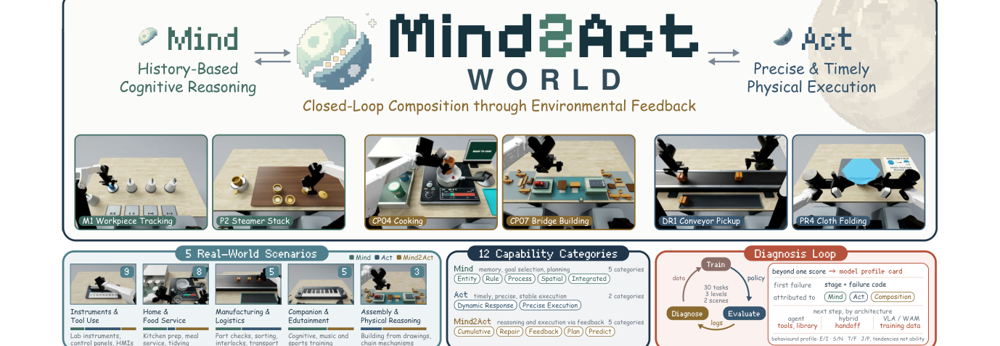
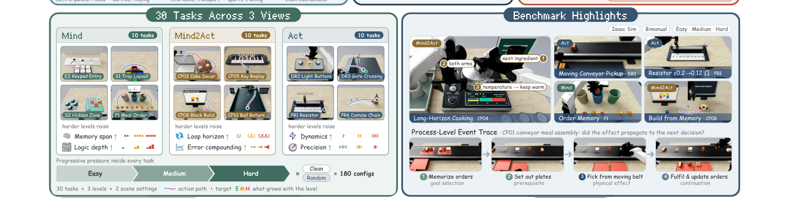
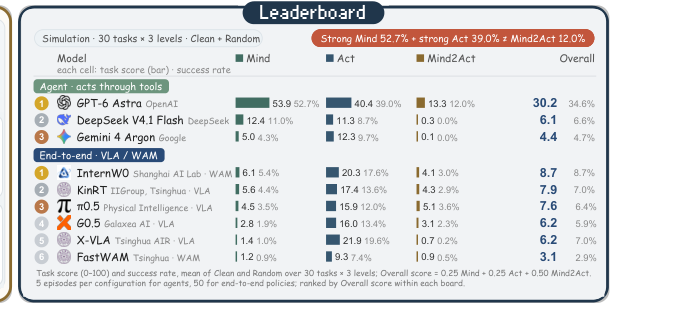

요리를 처음 배우는 사람을 상상해 봅시다.
- **레시피 외우기(Mind)** 시험을 보면 100점 만점에 **53점**을 맞습니다.
- **당근 썰기·프라이팬 뒤집기(Act)** 실기 시험을 보면 **39점**을 맞습니다.
- 그렇다면 **"레시피를 기억하면서 직접 요리해 손님상에 내놓기(Mind2Act)"**를 시키면 몇 점이 나올까요? 놀랍게도 **12점**으로 폭락합니다. 프라이팬에서 고기가 살짝 탔을 때(환경 피드백), 머릿속 레시피를 수정해 불을 줄이는 **'머리+손의 실시간 연결'**이 안 되기 때문입니다.

2026년 11월 19일 칭화대·케임브리지·옥스퍼드·스탠퍼드·CMU 공동 연구진이 공개한 [**Mind2Act World** (`arXiv:2611.26444`)](https://arxiv.org/abs/2611.26444)는 바로 이 문제를 짚어낸 논문입니다. 먼저 논문 **Figure 1 전체 구조**를 한눈에 본 뒤, **블록을 하나씩 확대**해서 왜 이 논문이 중요한지 직관적으로 살펴보겠습니다.

---

## 블록 ① 핵심 컨셉: 로봇의 능력을 '머리(Mind) · 손(Act) · 결합(Mind2Act)'으로 쪼개자

기존 로봇 시험장(벤치마크)들은 로봇이 실패하면 그냥 **"성공률 20%"**라는 총점 하나만 알려주었습니다. 이러면 엔지니어 입장에서는 인공지능의 추론 뇌를 고쳐야 할지, 로봇팔 모터 제어기를 고쳐야 할지 알 수가 없습니다.

위 확대 그림의 맨 위 배너를 보면 논문의 핵심 아이디어가 한 줄로 요약되어 있습니다:

- **Mind (History-Based Cognitive Reasoning = 기억하고 생각하는 머리):** 방금 전 어떤 컵에 공을 넣었는지, 손님이 어떤 순서로 주문했는지 **과거 기억을 바탕으로 다음 할 일을 결정**하는 능력입니다. (예: `M1 Workpiece Tracking`, `P2 Steamer Stack`)
- **Act (Precise & Timely Physical Execution = 정확하고 빠르게 움직이는 손):** 빠르게 흘러가는 컨베이어 벨트 위 물건을 타이밍 맞춰 집거나(`DR1 Conveyor Pickup`), 구겨지기 쉬운 천을 양손으로 깔끔하게 접는(`PR4 Cloth Folding`) **순수 손기술**입니다.
- **Mind2Act (Closed-Loop Composition = 눈으로 결과를 보며 머리와 손 연결하기):** 냄비 온도를 보며 다음 재료를 넣거나(`CP04 Cooking`), 블록이 무너지면 다시 쌓는(`CP07 Bridge Building`) 것처럼 **손으로 행동한 결과를 눈으로 확인하고 다음 생각을 고쳐 먹는 폐루프(Closed-Loop) 능력**입니다.
- **우측 하단 빨간 박스 (`Diagnosis Loop`):** 단순히 점수만 매기는 게 아니라, 로봇이 처음 실패한 순간을 포착해 **"이 모델은 손(Act)은 괜찮은데 머리-손 연결(Composition)에서 실패했다"**고 병원 진단서(**Model Profile Card**)를 뽑아줍니다.

---

## 블록 ② 어떻게 시험하나: 30개 작업 × 3단계 난이도 = 180가지 시험 문제

그렇다면 이 세 가지 능력을 어떻게 공정하게 테스트할까요? 가운데 블록을 확대해 보겠습니다.

- **왼쪽 녹색 박스 (`30 Tasks Across 3 Views`):**
  - `Mind` 전용 10문제, `Act` 전용 10문제, 둘을 합친 `Mind2Act` 10문제 — 총 **30개 양팔(Bimanual) 로봇 작업**을 준비했습니다.
  - 각 문제마다 난이도를 `Easy → Medium → Hard`로 올릴 수 있습니다.
    - `Mind` 문제는 난이도가 올라갈수록 **기억해야 할 길이(Memory span)**가 길어집니다.
    - `Act` 문제는 난이도가 올라갈수록 **벨트 속도(Dynamics)와 허용 오차(Precision, $\pm 0.2\Omega \rightarrow 0.12\Omega$)**가 빡빡해집니다.
    - `Mind2Act` 문제는 난이도가 올라갈수록 **작은 실수가 눈덩이처럼 커지는 구조(Error compounding)**가 됩니다.
- **오른쪽 파란 박스 (`Process-Level Event Trace`):**
  - 맨 아래 컨베이어 도시락 조립(`CP01`) 4단계를 보세요:
    `① 주문서 외우기 (머릿속 목표 선택) → ② 접시 세팅하기 (사전 준비) → ③ 움직이는 벨트에서 반찬 집기 (손기술) → ④ 담은 반찬을 확인하고 남은 주문 업데이트하기 (결과를 다음 생각에 반영!)`
  - 만약 로봇이 ③번에서 반찬을 떨어뜨렸는데도 ④번에서 아무 일 없었다는 듯 다음 주문으로 넘어가 버리면, **"Act 결과를 Mind로 전달하는 결합(Composition)이 깨졌다"**고 정확히 잡아내는 원리입니다.

---

## 블록 ③ 충격적인 성적표: 20개 이상의 최신 AI·VLA 모델을 줄 세워 보니

가장 흥미로운 부분은 오른쪽 아래 **Leaderboard(성적표)** 블록입니다. 크게 확대해서 숫자를 직접 확인해 보겠습니다.

연구진은 크게 두 진영의 최신 모델 20여 개를 테스트했습니다:
1. **위쪽 그룹 (`Agent · acts through tools`):** GPT-6 Astra, DeepSeek, Gemini처럼 거대한 언어·시각 뇌가 도구(Tool API)를 호출해 로봇을 움직이는 방식
2. **아래쪽 그룹 (`End-to-End · VLA / WAM`):** $\pi_{0.5}$(Physical Intelligence), InternWO, X-VLA처럼 카메라 화면을 보고 곧바로 모터 명령을 뱉는 로봇 전용 신경망

이 성적표가 말해주는 **3가지 핵심 교훈**은 아주 명확합니다:

1. **개별 과목 우등생도 합치면 낙제한다:** 1등을 차지한 에이전트조차 `Mind`에서 **52.7%**, `Act`에서 **39.0%**를 성공했지만, 둘을 합친 `Mind2Act`에서는 **12.0%**로 주저앉았습니다.
2. **거대 에이전트 vs 로봇 전용 VLA의 정반대 약점:**
   - **거대 에이전트(위쪽)**는 작업 상태를 기억하는 머리(`Mind`)는 좋지만, 물체와 계속 부딪히며 힘을 조절하는 물리 실행(`Act`)에서 자주 미끄러집니다.
   - 반대로 **End-to-End VLA/WAM(아래쪽, InternWO·$\pi_{0.5}$·X-VLA)**은 손기술(`Act` 12~19.6%)은 제법 숙련되어 있지만, 몇 단계 전에 뭘 했는지 기억하는 능력(`Mind` 1.0~5.4%)이 거의 없어 장기 작업(`Mind2Act` 0.2~3.6%)을 완주하지 못합니다.
3. **읽을 때 주의할 한계 (Caveat):** 이 실험은 모두 **NVIDIA Isaac Sim 시뮬레이터** 안에서 진행되었습니다. 시뮬레이터에서도 결합 성공률이 12%에 불과하다는 뜻은, 마찰과 센서 노이즈가 훨씬 심한 **실제 로봇(Real-world)**에서는 이 격차가 더 크게 벌어질 수 있음을 시사합니다.

---

## 내 로봇 시스템에 바로 적용할 포인트

- **VLA 하나로 모든 걸 끝내려 하지 말자:** $\pi_{0.5}$ 같은 최신 VLA도 '지금 눈앞의 동작(`Act`)'에는 강하지만 '과거 상태 기억(`Mind`)'에는 매우 취약합니다. 실제 로봇을 만들 때는 **① 상위에서 작업 진행 상태를 기록·검증하는 메모리 모듈**과 **② 하위에서 정밀 동작을 수행하는 VLA/MoveIt 2 제어기**를 분리하고, 동작 성공 여부를 반드시 상위 메모리에 피드백하는 구조를 잡아야 합니다.
