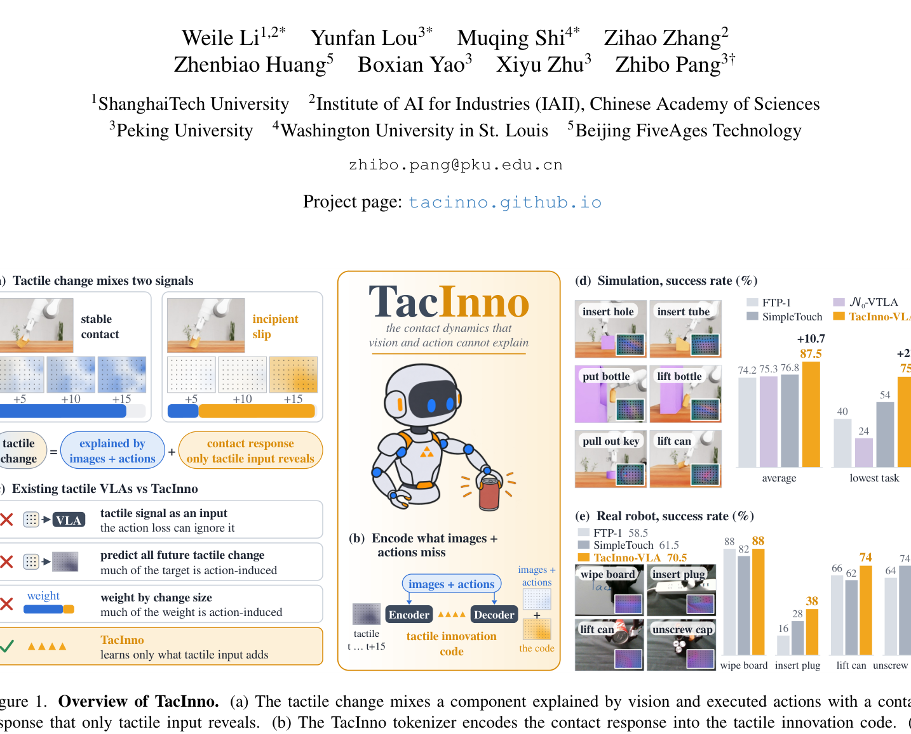
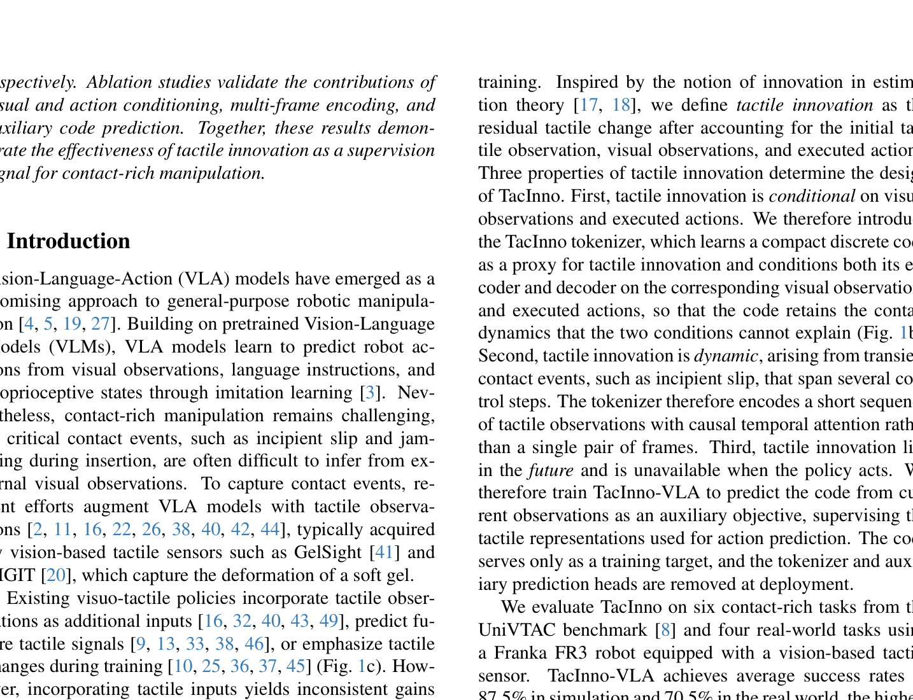
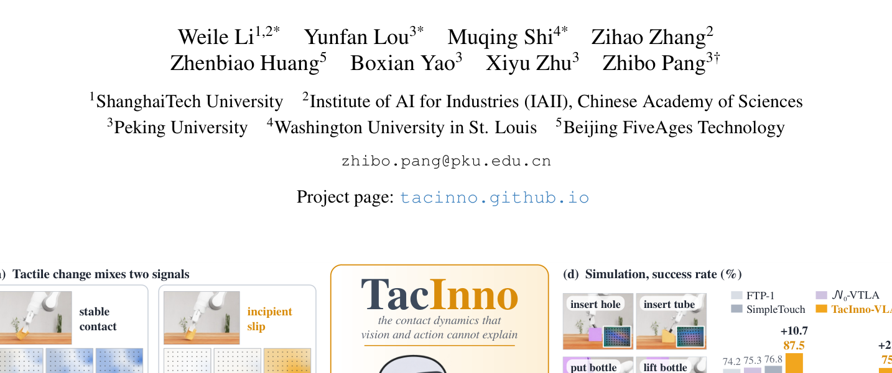
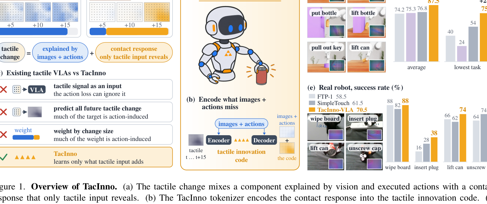

우리가 종이컵을 집어 들 때를 떠올려 봅시다. 손가락을 오므리면 손끝 살이 눌리는 느낌(촉각 변화)이 듭니다. 하지만 이 느낌의 상당 부분은 눈으로 본 컵의 위치와 내가 손가락을 오므린 정도(행동)만으로도 이미 뻔히 예측할 수 있는 변화입니다. 정작 중요한 순간은 컵이 스르르 미끄러지기 시작하는 미세한 찰나(incipient slip)인데, 기존 촉각 기반 VLA(Vision-Language-Action) 모델들은 뻔한 변화와 진짜 중요한 접촉 신호가 뒤섞인 데이터를 그대로 다루다 보니 정작 촉각 정보를 무시하거나 비효율적으로 학습하곤 했습니다.

2026년 11월 19일 arXiv에 공개된 **「TacInno: Teaching Vision-Language-Action Models the Contact Dynamics Beyond Vision and Action」**([arXiv:2611.26405v1](http://arxiv.org/abs/2611.26405v1))는 바로 이 지점을 파고듭니다. 시각과 행동으로 설명되는 뻔한 촉각 변화는 걸러내고, 오직 촉각 센서만이 포착할 수 있는 순수한 접촉 역학인 **'촉각 혁신(tactile innovation)'**만을 추출해 정책(policy)의 학습 목표로 삼는 방식입니다.

## 블록 ① 핵심 컨셉

위 그림의 왼쪽 상단 `(a)`는 촉각 센서에 기록되는 신호가 두 가지 성분으로 섞여 있음을 직관적으로 보여줍니다.
- **안정적 접촉(stable contact, 왼쪽)**: 그리퍼가 물체를 쥐면서 젤(gel) 패드가 눌리는 변화가 `+5`, `+10`, `+15` 스텝에 걸쳐 나타납니다. 아래 파란색 막대처럼 이 변화의 대부분은 카메라 이미지와 로봇이 실행한 행동(`images + actions`)만으로도 충분히 설명됩니다.
- **초기 미끄러짐(incipient slip, 오른쪽)**: 물체가 미세하게 미끄러지기 시작할 때는 시각이나 행동만으로는 설명할 수 없는 노란색 막대 영역, 즉 **오직 촉각 입력만이 드러내는 접촉 반응(contact response only tactile input reveals)**이 급격히 커집니다.

기존 방식들은 이 두 신호를 분리하지 못한 채 촉각을 단순 추가 입력으로 넣거나(행동 손실이 촉각을 무시해 버림), 미래의 모든 촉각 변화를 통째로 예측하게 만들었습니다(타깃의 대부분이 행동으로 유발된 뻔한 변화).

이를 해결하기 위해 저자들은 추정 이론(estimation theory)의 'innovation(예측 오차·잔여 정보)' 개념을 차용해 **TacInno**를 제안합니다. 핵심 흐름은 다음과 같습니다.
1. **조건부 입력**: `TacInno 토크나이저`의 인코더(Encoder)와 디코더(Decoder) 모두에 시각 관측과 실행된 행동(`images + actions`)을 조건(condition)으로 넣어줍니다.
2. **핵심 모듈 (인코딩)**: 인코더는 현재부터 미래 시점까지의 짧은 촉각 시퀀스(`t ... t+15`)를 인과적 시간 어텐션(causal temporal attention)으로 받아, `images + actions`로 이미 설명되는 부분을 뺀 나머지 잔여 접촉 역학만을 **이산 코드(tactile innovation code)**로 압축합니다.
3. **출력 및 정책 학습**: 디코더는 이 코드와 `images + actions`를 합쳐 미래 촉각 변화를 복원하도록 학습됩니다. 이렇게 만들어진 코드는 **오직 VLA 정책(`TacInno-VLA`)의 보조 학습 타깃(auxiliary objective)**으로만 사용됩니다. 정책은 현재 관측으로부터 이 미래 코드를 예측하도록 훈련되며, 실제 로봇 배포(deployment) 시에는 토크나이저와 보조 예측 헤드를 모두 제거하므로 추가 연산 모듈이 전혀 붙지 않습니다.

## 블록 ② 세부 구조 및 실험 결과

그림의 `(b)`와 `(c)`는 TacInno가 기존 촉각 VLA(`tactile signal as an input`, `predict all future tactile change`, `weight by change size`)와 어떻게 다른지 요약합니다. 기존 방식들이 행동으로 유발된 신호에 가중치가 쏠리는 반면, TacInno는 **"촉각 입력이 순수하게 더해주는 정보"**만 노란색 삼각형 코드(`tactile innovation code`)로 분리해 학습합니다.

정량 평가 결과(`(d)`, `(e)`)는 다음과 같습니다.
- **시뮬레이션 (UniVTAC 벤치마크 6개 태스크)**: `insert hole`, `insert tube`, `put bottle`, `lift bottle`, `pull out key`, `lift can`에서 **평균 성공률 87.5%**를 기록했습니다. 가장 강력한 시촉각 베이스라인인 SimpleTouch(76.8%)보다 **+10.7%p** 높으며, FTP-1(74.2%)과 $\mathcal{N}_0$-VTLA(75.3%)를 모두 앞섰습니다. 특히 가장 점수가 낮은 태스크(lowest task) 기준 성공률도 75%로, SimpleTouch(54%) 대비 **+21%p** 향상되었습니다.
- **실제 로봇 (Franka FR3 + 비전 기반 촉각 센서, 4개 태스크)**: **평균 성공률 70.5%**로 SimpleTouch(61.5%) 대비 **+9.0%p**, FTP-1(58.5%) 대비 +12.0%p 높은 성능을 보였습니다. 태스크별로는 `wipe board` 88%(FTP-1 88%, SimpleTouch 82%), `insert plug` 38%(FTP-1 16%, SimpleTouch 28%), `lift can` 74%(FTP-1 66%, SimpleTouch 62%), `unscrew cap` 82%(FTP-1 64%, SimpleTouch 74%)를 기록했습니다.
- **절제 연구(Ablation)**: 시각·행동 조건부 인코딩, 다중 프레임 인코딩(`t ... t+15`), 보조 코드 예측 학습 각각이 성능 향상에 기여함이 검증되었습니다.

**한계 및 주의할 점(Caveat)**:
- 실제 로봇 검증이 단일 매니퓰레이터(Franka FR3)와 비전 기반 촉각 센서 환경의 4개 태스크에 국한되어 있으며, 압저항·정전용량 방식 등 다른 촉각 센서나 양손·다지(multi-finger) 핸드 환경에서의 일반화는 확인되지 않았습니다.
- 실제 로봇에서 정밀 정렬과 접촉이 까다로운 `insert plug` 태스크는 베이스라인 대비 크게 오르긴 했으나 여전히 **38%**의 성공률에 머물러 있어, 초정밀 삽입 작업에서는 추가적인 개선이 필요합니다.
- 배포 시 제거되는 것은 토크나이저와 코드 예측 헤드이며, 정책 입력단에서의 촉각 센서 관측 자체는 여전히 활용된다는 점을 구분해 이해해야 합니다.

## 내 로봇 시스템에 적용할 포인트

- **센서 퓨전 시 '잔여 정보(Innovation)' 타깃 설계**: 카메라와 조인트 상태만으로 뻔히 예측되는 센서 변화(예: 그리퍼 닫힘에 따른 젤 변형, 자중 의한 토크 변화)를 그대로 예측 타깃으로 주면 모델이 숏컷(shortcut) 학습에 빠지기 쉽습니다. 정책을 학습할 때 시각·행동 조건부 오토인코더로 '예측 불가능한 잔여 신호'만 분리해 보조 손실(auxiliary loss)로 거는 패턴을 그대로 차용할 수 있습니다.
- **단일 프레임 차분 대신 짧은 시퀀스 인코딩**: 초기 미끄러짐(incipient slip)이나 끼임(jamming) 같은 접촉 역학은 한 프레임이 아니라 여러 제어 스텝에 걸쳐 발현됩니다. 접촉 이벤트 감지가 중요한 태스크라면 `t`와 `t+1`의 단순 차분 대신 `t ... t+15` 같은 짧은 윈도우를 인과적 시간 어텐션으로 묶어 인코딩하는 설계가 유리합니다.
- **추론 지연(Latency) 없는 학습 신호 활용**: 토크나이저와 보조 헤드를 학습 시에만 쓰고 배포 시 떼어내는 구조는 실시간 제어 주기(control frequency)가 빠듯한 로봇 시스템에서 추론 오버헤드 없이 표현력(representation)만 끌어올릴 수 있는 실용적인 전략입니다.
