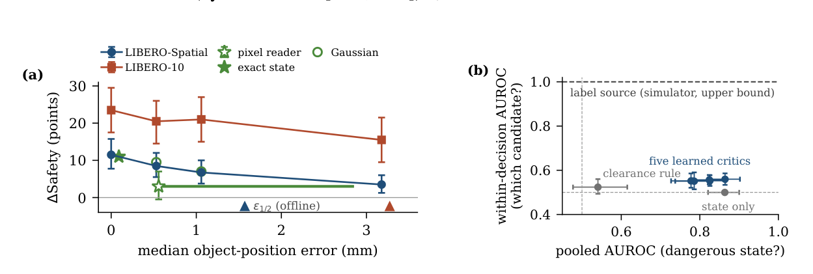
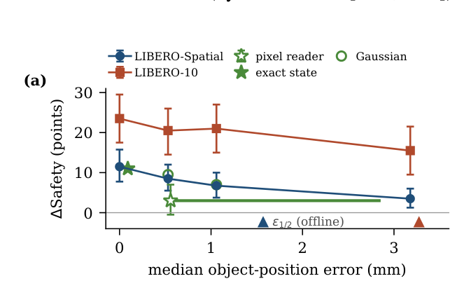
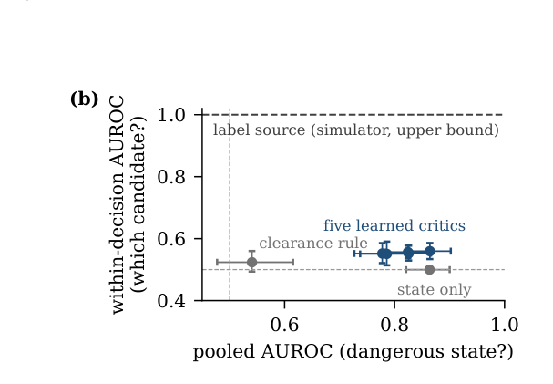

절벽 근처에서 운전할 때, 조수석 친구가 "어, 여기 절벽이라 위험해!"라고 외치는 것과 "지금 핸들을 왼쪽으로 5도 꺾어야 돌을 피할 수 있어!"라고 알려주는 것은 완전히 다른 문제입니다. 최근 로봇 제어에서 대세로 떠오른 VLA(Vision-Language-Action) 모델도 똑같은 딜레마에 빠져 있습니다. 예를 들어 LIBERO-10 벤치마크에서 $\pi_{0.5}$ 모델은 작업 성공률 88.0%를 기록할 만큼 일을 잘하지만, 목표가 아닌 물체를 건드리거나 과도한 힘을 주고 들고 있던 물체를 기울이는 등 안전 규칙을 어기지 않고 끝낸 비율은 70.5%에 불과합니다.

VLA는 확률적으로 행동을 생성하기 때문에, 테스트 시점에 여러 개의 행동 후보(action chunk)를 뽑아본 뒤 **월드 모델(World Model)**로 미래를 미리 내다보고 가장 안전한 행동을 고르는 '룩어헤드 안전 필터(Lookahead Safety Filter)'를 쓸 수 있습니다. 그렇다면 이 월드 모델은 도대체 무엇을 얼마나 잘해야 할까요? 2026년 11월 22일 공개된 논문 **「Detecting Is Not Choosing: What a World Model Needs to Keep a VLA Policy Safe」**([arXiv:2611.29553v1](http://arxiv.org/abs/2611.29553v1))는 시뮬레이터 자체를 '완벽한 월드 모델'로 삼고, 여기에 오차를 주거나 학습된 모델들과 비교해 이 질문에 정면으로 답합니다.

위 전체 그림은 이 논문의 핵심 결론 두 가지를 한눈에 보여줍니다. 왼쪽 **(a)**는 월드 모델이 시작 상태(물체 위치)를 조금만 잘못 알아도 안전 필터의 효과가 어떻게 무너지는지를, 오른쪽 **(b)**는 기존 학습 모델들이 '위험한 상황 감지'와 '안전한 후보 선택' 사이에서 얼마나 큰 괴리를 보이는지를 나타냅니다.

## 블록 ① 핵심 컨셉

이 논문이 검증하는 **룩어헤드 안전 필터**의 흐름은 직관적입니다.
`현재 로봇·물체 상태 복사(입력) → 여러 후보 행동 시뮬레이션(핵심 모듈) → 안전 위반이 가장 적은 후보 실행(출력)`의 구조입니다.
시뮬레이터 자체를 완벽한 월드 모델로 사용해 미래를 굴려보면, LIBERO의 3개 VLA 정책과 LIBERO-Plus의 $\pi_{0.5}$에서 안전율이 **11.5~25.7포인트** 상승했고 RoboCasa의 3개 태스크에서도 $\pi_{0.5}$의 안전성이 개선되었습니다.

하지만 현실에서는 시뮬레이터처럼 완벽한 현재 상태를 알 수 없기 때문에, 카메라 영상 등에서 물체 위치를 추정해 넣어야 합니다. 위 확대 그림 **(a)**는 바로 이 지점에서 발생하는 병목을 보여줍니다.
* **중앙값 3.18 mm 오차의 타격**: 가로축은 물체 위치 오차의 중앙값(mm), 세로축은 필터 적용 전 대비 안전율 향상폭($\Delta\text{Safety}$)입니다. 오차가 0 mm인 `exact state`(초록색 꽉 찬 별)에서는 높은 안전 향상폭을 얻지만, LIBERO-Spatial(파란색 선)에서 중앙값 오차가 **3.18 mm**까지 커지면 안전 개선 효과의 **70%가 사라집니다**. 위치 오차가 미래 예측뿐 아니라 안전 여부를 판별하는 변위 체크(displacement check) 자체도 망가뜨리기 때문입니다. (반면 LIBERO-10(빨간색 선)에서는 손실이 더 작고 신뢰구간이 겹칩니다.)
* **중앙값이 전부가 아니다**: 그림에서 속이 빈 초록색 별(`pixel reader`)과 초록색 동그라미(`Gaussian`)를 비교해 보세요. 두 방식은 중앙값 오차가 약 0.56 mm로 비슷하지만, 픽셀 기반 추정기(`pixel reader`)는 가우시안 오차보다 안전 향상폭을 **6.5포인트나 덜 보존**합니다. 초록색 별 옆으로 길게 뻗은 가로 막대가 보여주듯, 평균이나 중앙값은 작아 보여도 가끔 크게 빗나가는 **꼬리 오차(tail error)**와 로봇이 **직접 다루는 물체(handled objects)**에 대한 오차가 안전 필터의 성능을 크게 갉아먹기 때문입니다.

## 블록 ② 세부 구조 및 실험 결과

그렇다면 시뮬레이터 대신 딥러닝으로 학습한 크리틱(critic)이나 동역학·비디오 월드 모델을 쓰면 어떨까요? 확대 그림 **(b)**는 기존 평가 방식의 착시를 날카롭게 지적합니다.

* **감지(Detecting) vs. 선택(Choosing)**: 가로축 `pooled AUROC`는 전체 데이터셋에서 "이 상태가 위험한가?"를 가려내는 점수이고, 세로축 `within-decision AUROC`는 **특정 한 시점에 서 있을 때** "여러 후보 행동 중 어떤 것이 안전한가?"를 순서대로 매기는 점수입니다. 맨 위 점선(`1.0`)이 시뮬레이터 상한선이고, 아래 점선(`0.5`)은 동전 던지기(무작위 추측) 수준입니다.
* **학습된 모델들의 한계**: 파란색 점으로 표시된 5개의 학습된 크리틱(`five learned critics`)은 가로축 `pooled AUROC`에서는 **최대 0.864**라는 준수한 점수를 받았습니다. 하지만 정작 안전 필터에 필요한 세로축 `within-decision AUROC`는 **0.551~0.560**에 머물러, 사실상 무작위 선택(`0.50`)과 큰 차이가 없었습니다. 논문에서 테스트한 학습 기반 동역학 모델과 비디오 모델 역시 이보다 나은 결과를 내지 못했습니다. (`state only` 모델은 가로축 0.86대, 세로축 0.50으로 후보 구분을 전혀 못 하며, 단순 거리 기반 `clearance rule`도 0.5대 초반에 그쳤습니다.)

**아직 검증되지 않은 한계(Caveat)**:
1. 모든 실험과 안전율 개선 검증은 **시뮬레이션 환경**(LIBERO, LIBERO-Plus, RoboCasa) 내에서만 수행되었으며, 실제 물리 로봇 환경에서의 검증은 포함되지 않았습니다.
2. 완벽한 월드 모델 실험 역시 논문에서 정의한 특정 안전 위반 규칙을 기준으로 동작하므로, 다른 안전 규칙을 적용했을 때의 결과는 달라질 수 있습니다.

## 내 로봇 시스템에 적용할 포인트

* **평가 지표부터 바꾸세요**: VLA용 안전 크리틱이나 월드 모델을 검증할 때 전체 에피소드를 섞어 측정하는 `pooled AUROC`에 속으면 안 됩니다. 반드시 한 시점 내 여러 후보를 비교하는 **`within-decision` 순위 정확도**를 핵심 지표로 삼아야 합니다.
* **상태 추정기는 '꼬리 오차'와 '파지 물체'를 보세요**: 안전 필터 앞단에 비전 기반 포즈 추정기를 붙인다면, 중앙값 오차(mm)가 작다는 이유만으로 안심해선 안 됩니다. 드물게 발생하는 큰 오차(tail error)와 로봇 손이 쥐고 조작하는 물체의 위치 정확도를 최우선으로 관리해야 합니다.
* **안전 판별 로직의 내결함성 점검**: 상태 추정 오차는 미래 궤적을 예측할 때만 문제를 일으키는 것이 아니라, 예측 결과로부터 "물체가 밀렸는가?"를 계산하는 **안전 체크 수식 자체**도 오염시킨다는 점을 시스템 설계 시 함께 고려해야 합니다.
