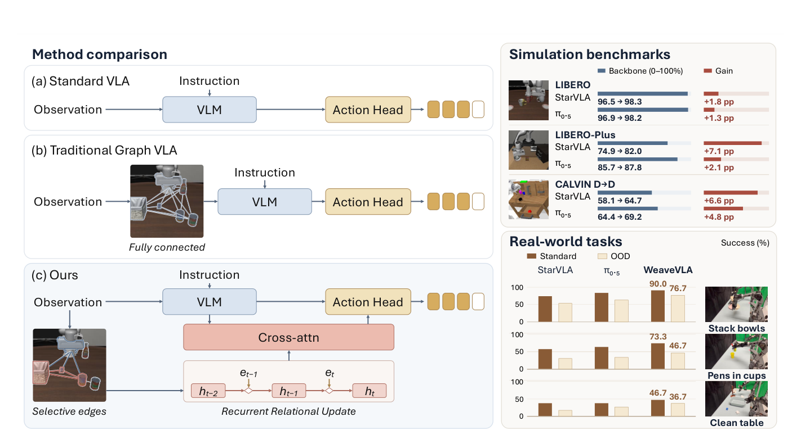
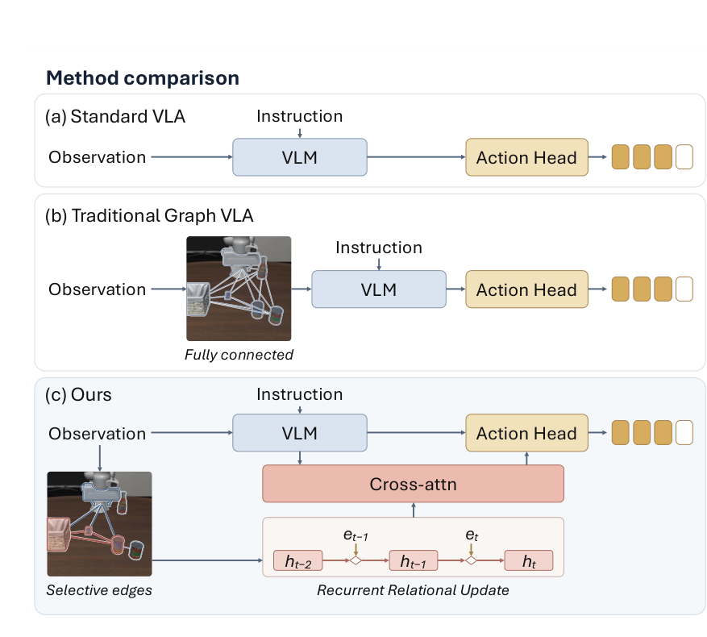
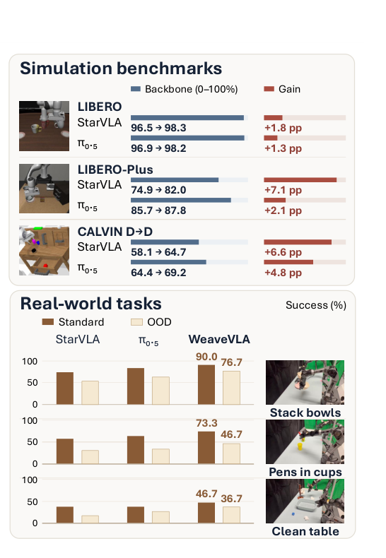

식탁 위의 컵을 집어 작은 바구니에 담는 행동을 상상해 보세요. 우리 뇌는 방 안의 벽지나 맞은편 의자의 위치를 일일이 계산하지 않습니다. 오직 '내 손과 컵 사이의 거리', 그리고 '컵과 바구니 사이의 상대적인 높이'만을 집중해서 바라보며 손을 움직입니다. 심지어 손이 컵을 가려서 컵 밑바닥이 잠시 안 보이더라도, 방금 전까지 어디에 있었는지 기억하고 있기 때문에 자연스럽게 작업을 이어갈 수 있습니다.

하지만 현재 널리 쓰이는 시각-언어-행동(VLA) 모델들은 2D 카메라 이미지 속에서 3D 공간 관계를 단순히 '감'으로 때려 맞추듯 암묵적으로 추론합니다. 반대로 기존의 그래프 기반 방식들은 시야 안의 모든 물체를 무차별적으로 엮어버려 불필요한 계산과 노이즈를 일으켰고, 시간이 지나면서 물체 배치가 바뀌거나 가려지는 상황을 기억하지 못했습니다.

이 문제를 해결하기 위해 홍콩과학기술대학교(HKUST) 등의 연구진은 작업에 꼭 필요한 물체 쌍의 3D 관계만을 골라내고, 이를 시간 흐름에 따라 순환 기억하는 프레임워크를 제안했습니다.
* **논문 원제**: WeaveVLA: 3D Relational Grounding for Vision-Language-Action Models
* **공개일**: 2026년 11월 23일
* **arXiv 링크**: [http://arxiv.org/abs/2611.31126v1](http://arxiv.org/abs/2611.31126v1)

---

## 블록 ① 핵심 컨셉

기존 VLA 방식들과 WeaveVLA의 결정적인 구조적 차이는 '3D 공간 관계를 어떻게 다루고 전달하느냐'에 있습니다.

그림 속 세 가지 구조의 흐름(`입력 → 핵심 모듈 → 출력`)을 살펴보면 연구팀의 핵심 아이디어가 명확히 드러납니다.

1. **(a) Standard VLA (표준 방식의 병목)**:
   * **흐름**: 입력 영상(Observation)과 지시문(Instruction) $\rightarrow$ VLM $\rightarrow$ Action Head $\rightarrow$ 제어 액션
   * **한계**: 2D 픽셀 토큰만으로 공간의 깊이와 상대적 기하 관계를 암묵적으로 추정해야 하므로, 물체를 정밀하게 정렬하거나 집어 올릴 때 공간적 오차가 발생하기 쉽습니다.

2. **(b) Traditional Graph VLA (전통적 3D 그래프 방식의 병목)**:
   * **흐름**: 입력 영상 속 객체들을 완전 연결(Fully connected)한 3D 그래프 $\rightarrow$ VLM $\rightarrow$ Action Head
   * **한계**: 작업과 전혀 상관없는 물체들 사이의 선(Edge)까지 무차별적으로 계산하여 모델에 심각한 노이즈를 줍니다. 또한 프레임 단위로만 그래프를 만들어, 로봇 손에 물체가 가려지거나 시점이 조금만 흔들려도 이전의 공간 문맥이 단절됩니다.

3. **(c) WeaveVLA (제안 방법의 핵심 메커니즘)**:
   * **선별적 엣지(Selective Edges)**: 지시문과 연관된 그리퍼, 작업 대상 물체, 목표 지점 등 필수 노드만 연결하는 작업 조건부 희소 그래프(Sparse GNN)를 구성합니다.
   * **순환 관계 업데이트(Recurrent Relational Update)**: 시간에 따라 기하 정보가 변하는 과정을 순환 상태($h_{t-2} \rightarrow h_{t-1} \xrightarrow{e_t} h_t$)로 엮어냅니다. 이전 시점의 공간 기억($h_{t-1}$)에 현재 관측된 엣지 정보($e_t$)를 누적 업데이트하므로, 일시적인 가림(Occlusion)이나 센서 오차가 발생해도 흔들리지 않고 3D 맥락을 유지합니다.
   * **교차 주의집중(Cross-attn) 결합**: 업데이트된 그래프 정보를 학습된 쿼리(Learned-query)로 압축해 컴팩트한 '관계 토큰(Relational Tokens)'으로 요약한 뒤, VLM의 시각-언어 문맥과 결합하여 Action Head에 공급합니다. 여기에 보조 기하 재구성 손실(Auxiliary geometry reconstruction)을 더해 모델이 공간 구조를 온전히 보존하도록 유도합니다.

---

## 블록 ② 세부 구조 및 실험 결과

연구진은 WeaveVLA를 대표적인 오픈소스 정책 백본인 **StarVLA-GR00T**와 최신 Flow 기반 정책인 **$\pi_{0.5}$** 두 가지에 결합하여 성능을 검증했습니다.

### 확인된 정량 수치 및 결과

1. **시뮬레이션 벤치마크 (Simulation benchmarks)**:
   * **LIBERO**: StarVLA(96.5% $\rightarrow$ 98.3%, **+1.8%p**), $\pi_{0.5}$(96.9% $\rightarrow$ 98.2%, **+1.3%p**)로 두 백본 모두 평균 98% 이상의 성공률을 기록했습니다.
   * **LIBERO-Plus (공간 변화 및 교란이 추가된 환경)**: StarVLA에서 74.9%에서 82.0%로 **+7.1%p** 대폭 상승했으며, $\pi_{0.5}$에서도 85.7%에서 87.8%로 **+2.1%p** 향상되었습니다.
   * **CALVIN D$\rightarrow$D**: 장기 조작 환경에서도 StarVLA 58.1% $\rightarrow$ 64.7%(**+6.6%p**), $\pi_{0.5}$ 64.4% $\rightarrow$ 69.2%(**+4.8%p**)로 일관된 성능 개선을 보였습니다.

2. **실물 로봇 조작 과제 (Real-world tasks)**:
   * **과제 구성**: '그릇 쌓기(Stack bowls)', '펜을 컵에 꽂기(Pens in cups)', '테이블 정리(Clean table)' 3종 평가.
   * **정량 성과**: StarVLA 백본 기반 WeaveVLA는 표준 조건(Standard)에서 평균 성공률 **70.0%**(기존 55.6% 대비 상승), 분포 외 섭동(OOD Perturbation) 조건에서 **53.3%**(기존 33.3% 대비 상승)를 기록하여 두 환경 모두에서 기본 $\pi_{0.5}$ 베이스라인의 실물 성공률을 뛰어넘었습니다.
   * **세부 태스크별 성공률**:
     * Stack bowls: 표준 90.0% / OOD 76.7%
     * Pens in cups: 표준 73.3% / OOD 46.7%
     * Clean table: 표준 46.7% / OOD 36.7%

### 아직 검증되지 않은 한계 (Caveats)

* **상류 인식 모듈 의존성**: 희소 그래프를 빌드하기 위해서는 장면 내 주요 물체와 그리퍼의 3D 바운딩 박스나 포인트 클라우드를 추출하는 전처리 검출기의 안정성이 전제되어야 합니다.
* **비정형/변형체 물체 제어**: 천, 끈, 액체와 같이 노드나 중심점(Centroid)을 명확한 강체(Rigid body)로 정의하기 힘든 변형체 물체 조작에 대한 실험적 검증은 포함되어 있지 않습니다.

---

## 내 로봇 시스템에 적용할 포인트

* **시계열 순환 엣지(Recurrent Edge) 메모리 도입**:
  로봇 매니퓰레이션 중 엔드이펙터에 의해 타깃 물체가 시야에서 가려지는 오클루전은 흔한 실패 원인입니다. 프레임마다 3D 포즈를 새로 추정하기보다, 직전 시점의 상대적 기하 관계 벡터를 Recurrent 상태($h_t$)로 누적 전달하는 구조를 적용해 정책의 안정성을 즉각 확보할 수 있습니다.
* **Fully-Connected 대신 Task-Conditioned Sparse Graph 설계**:
  장면 내 모든 객체를 연결하면 토큰 수와 연산량이 폭증하고 불필요한 시각적 노이즈가 주입됩니다. 지시문 텍스트에서 추출한 '그리퍼-조작 대상-배치 목표' 관계만 선별 엣지(Selective Edges)로 한정하여 온디바이스 제어 주기를 방해하지 않는 경량 그래프를 구축하세요.
* **Learned Query 기반 Cross-Attention 플러그인 아키텍처**:
  기존 거대 VLM 백본 내부를 무겁게 파인튜닝하지 않고도, Action Head 직전에 공간 관계 토큰을 Readout하여 조건(Conditioning)으로 주입하는 모듈형 설계 방식을 차용할 수 있습니다.
