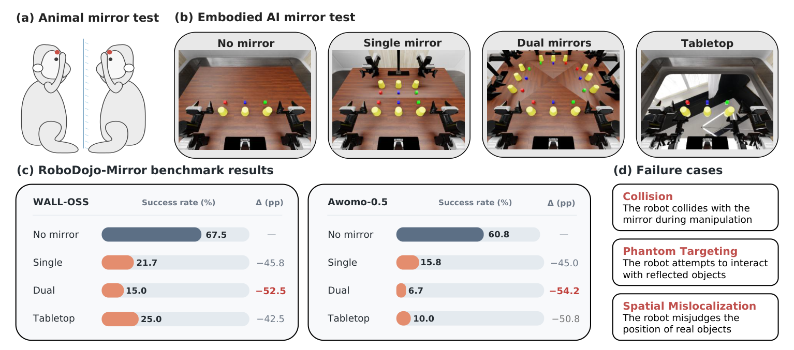
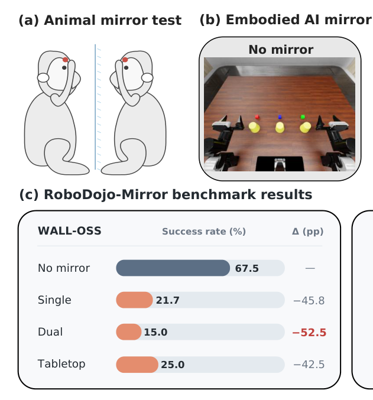
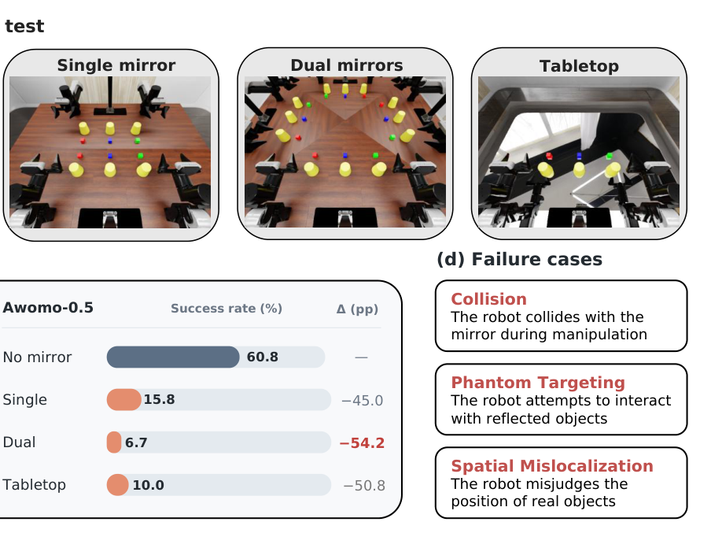

카페 유리창이나 스테인리스 조리대, 욕실 거울 앞에 서 본 강아지가 거울 속 자기 모습을 다른 강아지로 착각해 짖는 모습을 본 적이 있을 것입니다. 동물 인지 과학에서는 동물이 거울 속 이미지를 '나 자신'과 '허상'으로 구분할 수 있는지 확인하는 **거울 자기인식 테스트(Mirror Test)**를 오래전부터 사용해 왔습니다. 그렇다면 최신 비전-언어-행동(VLA) 모델이나 월드 모델로 움직이는 로봇 팔은 어떨까요? 실제 물체와 거울에 비친 가짜 물체를 구분하고 정확히 집어 올릴 수 있을까요?

2026년 11월 24일 공개된 논문 **「Embodied AI Fails the Mirror Test: How a Simple Mirror Breaks Robot Policies」**([arXiv:2611.33010v1](http://arxiv.org/abs/2611.33010v1))는 바로 이 질문에 정면으로 답합니다. 연구진은 로봇 정책이 거울 반사가 포함된 환경에서 얼마나 쉽게 무너지는지 체계적으로 측정하는 **RoboDojo-Mirror** 벤치마크를 구축하고, 최신 로봇 정책들이 거울 앞에서 최대 62.5%p까지 성공률이 급락한다는 사실을 밝혀냈습니다.

위 전체 그림(Figure 1)은 이 연구의 출발점부터 실험 구성, 대표 모델의 성능 하락폭, 그리고 실패 원인 분류까지 한눈에 보여줍니다. 이제 그림을 두 블록으로 나누어, 연구진이 어떤 방식으로 거울 테스트를 설계했고 로봇들이 왜 실패했는지 하나씩 짚어보겠습니다.

## 블록 ① 핵심 컨셉

기존 로봇 벤치마크들은 대부분 반사가 없는 매트한 나무 테이블이나 단순한 실험실 배경에서 성능을 측정해 왔습니다. 하지만 현실의 주방, 병원, 매장에는 스테인리스 표면, 유리문, 거울 등 빛을 반사하는 물체가 널려 있습니다. 기존 정책의 병목은 **카메라에 들어온 2D 픽셀 정보를 물리적 3D 실체와 구별하지 못하고 그대로 행동으로 연결한다**는 점에 있습니다.

연구진은 이 문제를 공정하게 진단하기 위해 RoboDojo 시뮬레이터 기반의 **RoboDojo-Mirror**를 제안했습니다. 핵심 아이디어는 매우 명쾌합니다. **작업 목표(Task Objectives), 성공 기준(Success Criteria), 학습된 정책 체크포인트(Policy Checkpoints)는 전혀 바꾸지 않은 채**, 오직 환경의 반사 조건만 통제 변인으로 추가하는 것입니다.

위 블록 그림의 흐름을 따라가 보면 다음과 같습니다.
- **(a) Animal mirror test**: 이마에 붉은 점이 찍힌 동물이 거울을 보며 자기 자신을 인식하는지 살피는 고전적 인지 테스트에서 아이디어를 얻었습니다.
- **(b) No mirror (기준 환경)**: 아무런 거울도 없는 나무 테이블 위에 노란 컵과 빨강·파랑·초록 블록이 놓여 있고, 양팔 로봇이 이를 조작하는 기본 상태입니다.
- **(c) WALL-OSS 결과**: 기준 환경(No mirror)에서 **67.5%**의 준수한 성공률을 기록하던 VLA 계열 모델 WALL-OSS는 거울이 추가되자마자 성적이 수직 낙하합니다.

여기서 중요한 포인트는 "거울이라는 물리적 장애물이 생겨서 부딪히는 바람에 실패한 것 아닌가?"라는 의문을 차단한 점입니다. 연구진은 거울과 기하학적 모양·위치가 완전히 똑같지만 **빛을 반사하지 않는 무반사 패널(non-reflective panels)**을 대조군으로 세워 비교했습니다. 그 결과 거울 환경 특유의 실패 중 **50~88%**는 로봇이 패널과 물리적으로 접촉하지 않은 상태에서 발생했습니다. 즉, 단순히 벽에 부딪혀서가 아니라 **거울이 만들어낸 시각적 반사 그 자체가 정책의 판단을 교란**한 것입니다.

## 블록 ② 세부 구조 및 실험 결과

두 번째 블록 그림은 연구진이 설계한 세 가지 거울 시나리오와 그로 인해 드러난 정량적 붕괴, 그리고 로봇이 보인 세 가지 전형적인 오작동 패턴을 보여줍니다.

먼저 **(b) 거울 배치 구성**을 보면 현실에서 마주칠 법한 반사 상황을 단계별로 모사했습니다.
1. **Single mirror**: 테이블 뒤쪽에 거울 1개를 세워 두어, 로봇 정면 카메라에 실제 물체와 거울 속 물체가 동시에 찍히는 상황입니다.
2. **Dual mirrors**: 양옆 각도를 맞춰 거울 2개를 배치함으로써, 물체와 로봇 팔의 모습이 다중 반사되어 시각적 혼란을 극대화한 상황입니다.
3. **Tabletop**: 바닥면 자체가 거울로 된 테이블탑 환경으로, 천장 조명과 물체 아랫면이 반사되어 깊이감과 경계를 파악하기 극도로 어렵습니다.

연구진은 VLA 모델, 월드 액션 모델(World Action Model), 에이전트 기반 정책을 아우르는 **총 5개 정책**을 평가했습니다.
- **전체 성능 하락**: 5개 정책 모두 예외 없이 거울 조건에서 성공률이 떨어졌으며, 세 거울 조건 평균 하락폭은 **10.8%p에서 최대 56.7%p**에 달했습니다. 특히 거울 테이블탑(Tabletop) 조건에서는 최대 **62.5%p**까지 성공률이 추락했습니다.
- **세부 모델 수치(Figure 1c)**:
  - **WALL-OSS**: No mirror `67.5%` → Single `21.7%` (-45.8%p) → Dual `15.0%` (-52.5%p) → Tabletop `25.0%` (-42.5%p)
  - **Awomo-0.5**: No mirror `60.8%` → Single `15.8%` (-45.0%p) → Dual `6.7%` (-54.2%p) → Tabletop `10.0%` (-50.8%p)
- **실제 로봇(Real-robot) 검증**: 시뮬레이션에 그치지 않고 **$\pi_{0.5}$**와 **FastWAM** 모델을 실제 로봇에 올려 수직 거울 및 거울 테이블탑 조건을 테스트했을 때도 마찬가지로 전반적인 성공률 하락이 재현되었습니다.

그렇다면 로봇은 왜 실패했을까요? 연구진이 궤적(trajectory)과 접촉 데이터를 분석해 정리한 **(d) 세 가지 핵심 실패 유형**은 매우 직관적입니다.
1. **Collision (충돌)**: 조작 과정에서 거울 표면을 뚫고 지나갈 수 있는 빈 공간이나 열린 시야로 착각해 거울에 부딪힙니다.
2. **Phantom Targeting (유령 타기팅)**: 거울 속에 비친 가짜 물체(허상)를 실제 물체로 믿고 거울 쪽으로 팔을 뻗어 잡으려 시도합니다.
3. **Spatial Mislocalization (공간 위치 오판)**: 거울 반사로 인해 배경과 기하 구조가 왜곡되면서, 정작 책상 위에 놓인 **실제 물체의 위치조차 엉뚱하게 추정**합니다.

**한계점(Caveat)으로 짚어둘 부분**:
- 이 논문은 거울 환경에서의 취약점을 체계적으로 드러내고 진단(Diagnostic)하는 벤치마크 연구에 초점을 맞추고 있습니다. 따라서 거울 반사 문제를 해결하는 새로운 학습 알고리즘이나 모델 아키텍처를 직접 제안하지는 않았으며, 이는 후속 연구 과제로 남겨두었습니다.
- 또한 논문 초록과 공개된 Figure 1 기준으로는 WALL-OSS와 Awomo-0.5의 세부 조건별 수치 및 5개 정책의 전체 하락 범위(10.8~56.7%p)가 명확히 확인되며, 나머지 정책들과 실제 로봇 실험($\pi_{0.5}$, FastWAM)의 세부 수치 비교는 본문 상세 테이블 확인이 필요합니다.

## 내 로봇 시스템에 적용할 포인트

- **RGB 기반 정책의 '반사 환경' 스트레스 테스트 도입**: 현재 보유한 VLA나 모방학습 정책을 현장에 배포하기 전, 스테인리스·유리·거울이 포함된 시뮬레이션(예: 공개된 `robodojo-mirror` 코드)이나 실제 반사 패널 환경에서 Phantom Targeting이 발생하지 않는지 사전 검증 파이프라인을 추가하는 것이 좋습니다.
- **시각-기하 일관성 검증 및 멀티모달 융합 고려**: RGB 카메라 이미지만 맹신할 경우 거울 속 허상을 실제 타겟으로 오인하기 쉽습니다. 손목 카메라(wrist camera)와 메인 카메라 간의 다중 시점 기하 검증(multi-view consistency), 또는 촉각·힘/토크 센서와 비전 정보를 결합해 물리적 실체 여부를 확인하는 안전장치를 설계에 반영해야 합니다.
- **데이터 증강 시 반사(Specular/Mirror) 도메인 포함**: 기존의 도메인 무작위화(Domain Randomization)가 주로 조명 색온도나 배경 텍스처 변경에 머물렀다면, 테이블 표면의 반사율(roughness/metallic) 변화나 주변 유리·거울 오브젝트 배치를 학습 데이터에 포함해 정책이 '허상'을 무시하도록 유도할 필요가 있습니다.
