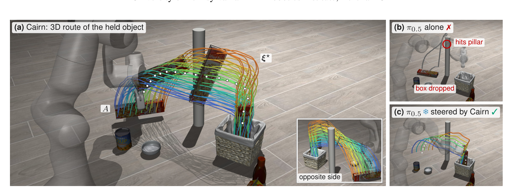
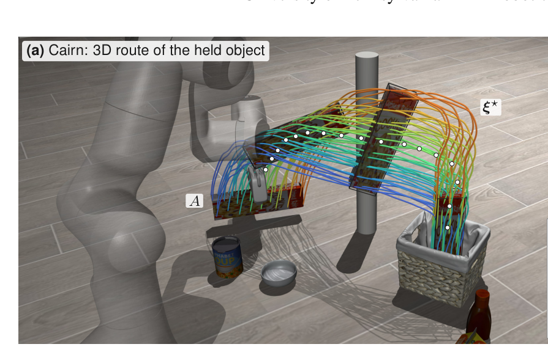
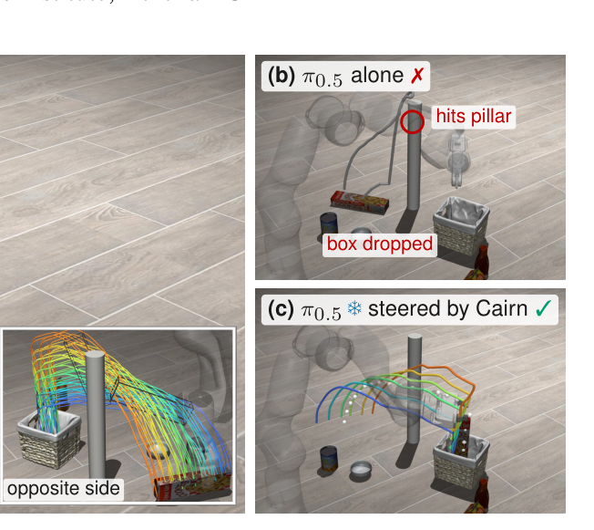

새집으로 이사를 한다고 상상해 봅시다. 무거운 책장을 들어 올리고 바닥에 내려놓는 '손기술'은 이미 몸에 배어 있습니다. 하지만 소파를 피해 돌아가고, 좁은 문틀을 통과하기 위해 책장을 비스듬히 기울이는 '경로'는 새집의 3차원 구조에 맞춰 매번 새로 짜야 합니다. 현재의 비전-언어-행동(VLA) 모델들도 딱 이 지점에서 막힙니다. 대규모 로봇 데이터로 학습한 VLA는 물건을 집고 놓는 기본 운동 능력은 뛰어나지만, 주로 2D 이미지에 의존해 짧은 행동 묶음(action chunk)을 한 번에 하나씩 결정하다 보니 학습 때 보던 환경 배치를 그대로 외워버립니다. 그 결과 물건 위치가 바뀌거나 중간에 장애물이 놓이면, 기존 경로대로 밀고 가다 장애물에 부딪히고 물건을 떨어뜨립니다. 그렇다고 새로운 배치마다 로봇 시연 데이터를 모아 파인튜닝을 하면, 기존에 잘하던 기술마저 망가지는 문제가 생깁니다.

펜실베이니아 대학교(University of Pennsylvania)와 아테나 RC(Athena RC) 연구진이 **2026년 11월 25일(UTC)** 공개한 논문 **「Cairn: Object-Centric 3D Trajectory Priors for Steering Frozen VLAs」**([arXiv:2611.34914v1](http://arxiv.org/abs/2611.34914v1))는 이 문제를 정면으로 돌파합니다. 핵심 해법은 VLA의 가중치를 **완전히 얼린(Frozen) 상태**로 두고, 로봇 손에 들린 물체가 3차원 공간에서 움직여야 할 '길잡이 궤적'을 별도의 작은 3D 모듈이 그려주어 테스트 시점에 VLA를 조향(Steering)하는 것입니다.

위 전체 그림(Figure 1)이 Cairn의 역할을 한눈에 보여줍니다.
- **(a) Cairn이 생성한 물체의 3D 경로**: 로봇 팔이 파지 자세 $A$에서 긴 과자 상자를 집은 뒤, 중간의 회색 기둥 장애물을 피해 바구니까지 이동하는 선택된 $SE(3)$ 경로($\xi^\star$)를 보여줍니다. 상자가 가로로 들렸다가 바구니 입구에 맞춰 세로로 회전하며 들어가는 모습이 무지개색 선으로 표현되어 있습니다.
- **(b) $\pi_{0.5}$ 단독 실행**: VLA 혼자 판단할 때는 기둥 장애물을 고려한 우회 경로를 잡지 못해 기둥에 부딪히고(`hits pillar`) 상자를 떨어뜨립니다(`box dropped`).
- **(c) Cairn으로 조향된 얼린 $\pi_{0.5}$(❄)**: 가중치를 전혀 재학습하지 않은 $\pi_{0.5}$ 모델이 Cairn의 궤적을 따라 기둥을 깔끔하게 돌아 바구니에 상자를 세워 넣는 데 성공합니다.

---

## 블록 ① 핵심 컨셉

기존 VLA의 가장 큰 병목은 **"로봇의 다음 짧은 움직임"만 2D 시점으로 본다**는 점입니다. 앞을 가로막는 기둥을 피하려면 기둥에 닿기 훨씬 전부터 우회 결정을 내려야 하고, 길쭉한 상자를 좁은 바구니에 넣으려면 이동하면서 상자의 3D 자세(회전)까지 미리 바꿔야 합니다.

Cairn은 이 역할을 로봇 팔 전체가 아닌 **'손에 잡힌 물체' 중심의 3D 경로 문제**로 분리해 해결합니다. 위 확대 그림을 따라 데이터와 제어의 흐름을 정리하면 다음과 같습니다.

1. **입력(Input)**: 작은 크기의 궤적 사전분포 모델(Prior)은 로봇이 물체를 집은 순간 **① 장면(Scene)의 3D 포인트 클라우드**, **② 들린 물체의 포인트 클라우드**, **③ 파지 시점의 물체 자세 $A$**, 그리고 **④ 언어 지시문(Instruction)**을 입력으로 받습니다.
2. **핵심 모듈(3D Trajectory Prior & 양방향 피드백)**:
   - 이 Prior는 물체를 놓기 직전(release)까지 장애물을 피해 돌아가고 틈새에 맞게 회전하는 여러 후보 $SE(3)$ 궤적(3D 위치 + 3D 회전)을 샘플링합니다. 그림에서 흰색 점들이 바로 이 선택된 궤적 $\xi^\star$ 위의 경유점(Waypoint)들이며, 무지개색 선들은 상자 표면의 각 점이 이동하면서 자연스럽게 수직으로 회전하는 궤적을 뜻합니다.
   - 여기서 Cairn의 중요한 설계는 Prior와 VLA가 **양방향 피드백(Bidirectional feedback)**을 주고받는 2단계 계층적 플래너(Hierarchical Planner)라는 점입니다.
     - **VLA → Prior (상향식 선택·재형성)**: 얼린 VLA가 원래 의도하는 움직임 정보를 바탕으로, Prior가 샘플링한 여러 경로 후보 중 가장 자연스러운 경로를 고르고 다듬습니다.
     - **Prior → VLA (하향식 디노이징 조향)**: 최종 선택된 궤적 $\xi^\star$는 VLA가 행동을 생성하는 **디노이징(Denoising) 과정**에 직접 개입합니다. VLA가 예측한 로봇 행동을 파지 정보(Grasp)를 통해 '들린 물체의 3D 자세'로 변환한 뒤, 그 자세가 궤적 상의 다음 흰색 경유점(Waypoint) 쪽으로 당겨지도록(pull) 유도합니다.
3. **출력(Output)**: VLA의 신경망 가중치는 단 하나도 건드리지 않은 채, 미세한 저수준 제어(그리퍼 안정성, 접촉 처리 등)는 VLA가 담당하고 거시적인 3D 우회·회전 경로는 Cairn이 잡아주는 조향된 로봇 행동이 출력됩니다.

---

## 블록 ② 세부 구조 및 실험 결과

오른쪽 블록을 확대한 그림에서는 **왜 기존 VLA가 실패하고 Cairn이 이를 어떻게 바로잡는지**가 더욱 극명하게 대비됩니다.
- 왼쪽 아래의 `opposite side` 인셋 뷰는 로봇 팔 반대편에서 본 3D 경로로, 상자가 기둥 뒤쪽으로 안전거리를 유지하며 부드럽게 꺾여 내려가는 기하학적 여유 공간을 보여줍니다.
- 반면 **(b) $\pi_{0.5}$ alone ✗**에서는 로봇이 기둥에 정면으로 충돌하며(`hits pillar`) 상자를 놓쳐버립니다(`box dropped`).
- **(c) $\pi_{0.5}$ ❄ steered by Cairn ✓**에서는 동일한 얼린 $\pi_{0.5}$ 모델이 파란색-초록색-주황색으로 이어지는 궤적 가이드를 따라 충돌 없이 바구니 안쪽으로 상자를 꽂아 넣습니다.

논문에서 검증된 핵심 정량 및 실환경 결과는 다음과 같습니다.
- **변형된 LIBERO 벤치마크 (1,941개 미학습 장면)**: 물체 위치가 이동되고 장애물이 추가된 1,941개의 평가(held-out) 장면에서, 얼린 $\pi_{0.5}$의 성공률을 **24.5%에서 95.1%**로 대폭 끌어올렸습니다. 이는 해당 학습 배치로 직접 파인튜닝한 $\pi_{0.5}$ 모델보다도 높은 성능이며, 기존 표준 LIBERO 태스크의 성능을 전혀 해치지 않았습니다.
- **제3자 벤치마크(LIBERO-PRO)**: 전체 성공률은 **27.3%에서 38.0%**로 상승했고, 특히 Cairn이 실제로 조향에 개입한 에피소드들에서는 성공률이 **54.4%에서 81.1%**로 크게 향상되었습니다.
- **실제 Franka 로봇 및 Sim-to-Real 검증**: 순수하게 **시뮬레이션 데이터만으로 학습된 Prior**를 이용해, 실제 Franka 로봇 위에서 얼린 **DROID $\pi_{0.5}$** 모델을 조향하는 데 성공했습니다. 기존 DROID $\pi_{0.5}$가 실패하던 '장애물 우회' 및 '로봇 팔 가동 범위(reach) 한계 지점에서의 물체 배치' 작업을 완수했습니다. (코드, 모델, 데이터는 공개 예정)

### 한계 및 주의점 (Caveats)
- **조향 구간 외의 실패는 해결하지 못함**: LIBERO-PRO에서 Cairn이 조향한 에피소드의 성공률은 81.1%에 달하지만 전체 벤치마크 성공률은 38.0%에 머뭅니다. 이는 Cairn이 '물체를 잡은 이후 놓기 전까지의 3D 경로'를 조향하는 데 특화되어 있어, 파지(Grasp) 이전 단계나 Prior가 개입하지 않는 구간에서 발생하는 VLA 자체의 실패까지 모두 해결하지는 못함을 시사합니다.
- **3D 인식 및 강체 가정 의존**: Prior가 작동하려면 장면과 들린 물체의 포인트 클라우드, 그리고 파지 순간의 물체 3D 자세($A$)가 주어져야 하며, 파지 이후 그립이 틀어지지 않고 로봇 행동이 물체 자세로 일관되게 매핑될 수 있어야 합니다.
- **미확인 세부 사양**: 공개된 초록 및 도입부 범위에서는 궤적 Prior 모델의 정확한 신경망 파라미터 크기, 테스트 시점 디노이징 조향에 추가되는 추론 지연 시간(Latency), 실제 Franka 로봇 실험의 구체적인 시행 횟수 및 성공률 수치는 확인되지 않았습니다.

---

## 내 로봇 시스템에 적용할 포인트

- **VLA 파인튜닝 대신 '모터 스킬'과 '3D 경로 플래닝'의 분리 고려**: 새로운 작업 공간이나 장애물 배치가 잦은 현장이라면, 거대 VLA를 매번 재학습해 기존 스킬이 망가지는(Skill erosion) 위험을 감수하기보다 VLA는 저수준 파지·조작 제어기로 얼려두고 가벼운 3D 기하 기반 플래너로 테스트 시점에 조향하는 하이브리드 구조가 훨씬 유지보수에 유리합니다.
- **디퓨전/플로우 기반 VLA의 테스트 시점 제어(Inference-time Steering) 활용**: $\pi_{0.5}$처럼 연속 행동을 디노이징으로 생성하는 정책 모델을 사용 중이라면, 모델 내부 가중치 수정 없이 디노이징 중간 단계의 예측 행동을 3D 작업 공간의 웨이포인트로 끌어당기는 가이던스 항을 추가하는 방식만으로 강력한 제약 조건(충돌 회피, 자세 정렬)을 주입할 수 있습니다.
- **Sim-to-Real 비용 절감을 위한 물체 중심(Object-centric) 표현 채택**: 픽셀 기반 VLA는 시뮬레이션과 실제 환경 간의 시각적 도메인 차이(Sim-to-Real gap)에 민감하지만, Cairn의 Prior처럼 장면과 물체의 3D 포인트 클라우드 및 $SE(3)$ 궤적만 다루면 시뮬레이션만으로 학습한 모듈을 실제 로봇(DROID $\pi_{0.5}$ + Franka)에 곧바로 이식할 수 있는 가능성이 크게 높아집니다.
